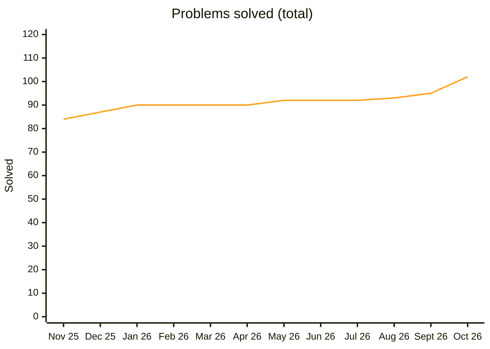

<!-- leetstash:stats:start -->

 

<b><a href="#ls-recent">Recent</a> &nbsp;·&nbsp; <a href="#ls-progress">Progress</a> &nbsp;·&nbsp; <a href="#ls-skills">Skills</a> &nbsp;·&nbsp; <a href="#ls-languages">Languages</a> &nbsp;·&nbsp; <a href="#ls-problems">All problems</a></b>

⏳ 288 solved problems still being imported from LeetCode.

## 🕒 Recent activity

| Date | Problem | Difficulty | Solution |
|---|---|---|---|
| 14 Oct 2026 | Sum of Squares of Special Elements  | 🟢 Easy | [Java](https://github.com/samy-D5/Leetcode/blob/main/Java/Array/2778-sum-of-squares-of-special-elements.md) |
| 11 Oct 2026 | Prime Subset Selection I | 🟡 Medium | [Java](https://github.com/samy-D5/Leetcode/blob/main/Java/Uncategorized/101193-prime-subset-selection-i.md) |
| 11 Oct 2026 | [Prime Subset Selection I](https://leetcode.com/problems/prime-subset-selection-i/) | 🟡 Medium | [Java](https://github.com/samy-D5/Leetcode/blob/main/Java/Uncategorized/4079-prime-subset-selection-i.md) |
| 11 Oct 2026 | Three Fibonacci Sum | 🟢 Easy | [Java](https://github.com/samy-D5/Leetcode/blob/main/Java/Uncategorized/101210-three-fibonacci-sum.md) |
| 11 Oct 2026 | [Three Fibonacci Sum](https://leetcode.com/problems/three-fibonacci-sum/) | 🟢 Easy | [Java](https://github.com/samy-D5/Leetcode/blob/main/Java/Uncategorized/4078-three-fibonacci-sum.md) |
| 9 Oct 2026 | Remove Outermost Parentheses | 🟢 Easy | [Java](https://github.com/samy-D5/Leetcode/blob/main/Java/Stack/1021-remove-outermost-parentheses.md) |
| 7 Oct 2026 | [Binary Tree Inorder Traversal](https://leetcode.com/problems/binary-tree-inorder-traversal/) | 🟢 Easy | [Java](https://github.com/samy-D5/Leetcode/blob/main/Java/Tree/0094-binary-tree-inorder-traversal.md) |
| 29 Sept 2026 | [Palindrome Linked List](https://leetcode.com/problems/palindrome-linked-list/) | 🟢 Easy | [Java](https://github.com/samy-D5/Leetcode/blob/main/Java/Two%20Pointers/0234-palindrome-linked-list.md) |
| 23 Sept 2026 | [Merge Two Sorted Lists](https://leetcode.com/problems/merge-two-sorted-lists/) | 🟢 Easy | [Java](https://github.com/samy-D5/Leetcode/blob/main/Java/Linked%20List/0021-merge-two-sorted-lists.md) |
| 22 Sept 2026 | [Remove Nth Node From End of List](https://leetcode.com/problems/remove-nth-node-from-end-of-list/) | 🟡 Medium | [Java](https://github.com/samy-D5/Leetcode/blob/main/Java/Two%20Pointers/0019-remove-nth-node-from-end-of-list.md) |

<a href="#ls-top">↑ Back to top</a>

## 📈 Progress over time

<a href="#ls-top">↑ Back to top</a>

## 🧠 Skills

_Topic coverage: a problem counts toward every topic it's tagged with._

| Topic | Solved | 🟢 Easy | 🟡 Medium | 🔴 Hard | |
|---|---|---|---|---|---|
| Array | **163** | 109 | 51 | 3 | `████████████████` |
| String | **127** | 86 | 41 | 0 | `████████████░░░░` |
| Math | **72** | 60 | 12 | 0 | `███████░░░░░░░░░` |
| Hash Table | **67** | 41 | 25 | 1 | `███████░░░░░░░░░` |
| Two Pointers | **49** | 27 | 22 | 0 | `█████░░░░░░░░░░░` |
| Database | **40** | 33 | 7 | 0 | `████░░░░░░░░░░░░` |
| Simulation | **36** | 25 | 11 | 0 | `████░░░░░░░░░░░░` |
| Sorting | **36** | 24 | 12 | 0 | `████░░░░░░░░░░░░` |
| Greedy | **29** | 13 | 16 | 0 | `███░░░░░░░░░░░░░` |
| Counting | **23** | 12 | 11 | 0 | `██░░░░░░░░░░░░░░` |
| Linked List | **21** | 9 | 12 | 0 | `██░░░░░░░░░░░░░░` |
| Stack | **20** | 11 | 8 | 1 | `██░░░░░░░░░░░░░░` |
| Uncategorized | **18** | 16 | 2 | 0 | `██░░░░░░░░░░░░░░` |
| Prefix Sum | **17** | 5 | 11 | 1 | `██░░░░░░░░░░░░░░` |
| Bit Manipulation | **16** | 10 | 6 | 0 | `██░░░░░░░░░░░░░░` |

52 more topics

| Topic | Solved | 🟢 Easy | 🟡 Medium | 🔴 Hard | |
|---|---|---|---|---|---|
| Binary Search | **14** | 8 | 6 | 0 | `█░░░░░░░░░░░░░░░` |
| Depth-First Search | **14** | 10 | 4 | 0 | `█░░░░░░░░░░░░░░░` |
| Tree | **14** | 10 | 4 | 0 | `█░░░░░░░░░░░░░░░` |
| Binary Tree | **13** | 9 | 4 | 0 | `█░░░░░░░░░░░░░░░` |
| Backtracking | **11** | 1 | 9 | 1 | `█░░░░░░░░░░░░░░░` |
| Dynamic Programming | **11** | 3 | 7 | 1 | `█░░░░░░░░░░░░░░░` |
| Matrix | **9** | 5 | 3 | 1 | `█░░░░░░░░░░░░░░░` |
| Recursion | **9** | 7 | 2 | 0 | `█░░░░░░░░░░░░░░░` |
| Breadth-First Search | **7** | 4 | 3 | 0 | `█░░░░░░░░░░░░░░░` |
| Divide and Conquer | **7** | 1 | 6 | 0 | `█░░░░░░░░░░░░░░░` |
| Enumeration | **7** | 7 | 0 | 0 | `█░░░░░░░░░░░░░░░` |
| Sliding Window | **6** | 2 | 4 | 0 | `█░░░░░░░░░░░░░░░` |
| String Matching | **6** | 5 | 1 | 0 | `█░░░░░░░░░░░░░░░` |
| Counting Sort | **5** | 4 | 1 | 0 | `█░░░░░░░░░░░░░░░` |
| Heap (Priority Queue) | **5** | 1 | 4 | 0 | `█░░░░░░░░░░░░░░░` |
| Number Theory | **5** | 3 | 2 | 0 | `█░░░░░░░░░░░░░░░` |
| Bracket Sequences | **4** | 2 | 2 | 0 | `█░░░░░░░░░░░░░░░` |
| Graph Theory | **3** | 3 | 0 | 0 | `█░░░░░░░░░░░░░░░` |
| Merge Sort | **3** | 0 | 3 | 0 | `█░░░░░░░░░░░░░░░` |
| Binary Search Tree | **2** | 1 | 1 | 0 | `█░░░░░░░░░░░░░░░` |
| Bubble Sort | **2** | 1 | 1 | 0 | `█░░░░░░░░░░░░░░░` |
| Combinatorics | **2** | 2 | 0 | 0 | `█░░░░░░░░░░░░░░░` |
| Design | **2** | 1 | 1 | 0 | `█░░░░░░░░░░░░░░░` |
| Floyd's Cycle Finding Algorithm | **2** | 1 | 1 | 0 | `█░░░░░░░░░░░░░░░` |
| Hash Function | **2** | 1 | 1 | 0 | `█░░░░░░░░░░░░░░░` |
| Monotonic Stack | **2** | 0 | 1 | 1 | `█░░░░░░░░░░░░░░░` |
| Quicksort | **2** | 1 | 1 | 0 | `█░░░░░░░░░░░░░░░` |
| Rolling Hash | **2** | 1 | 1 | 0 | `█░░░░░░░░░░░░░░░` |
| Trie | **2** | 2 | 0 | 0 | `█░░░░░░░░░░░░░░░` |
| Algorithm X | **1** | 0 | 0 | 1 | `█░░░░░░░░░░░░░░░` |
| Boyer–Moore Majority Vote Algorithm | **1** | 1 | 0 | 0 | `█░░░░░░░░░░░░░░░` |
| Brainteaser | **1** | 0 | 1 | 0 | `█░░░░░░░░░░░░░░░` |
| Bucket Sort | **1** | 0 | 1 | 0 | `█░░░░░░░░░░░░░░░` |
| Concurrency | **1** | 1 | 0 | 0 | `█░░░░░░░░░░░░░░░` |
| Doubly-Linked List | **1** | 0 | 1 | 0 | `█░░░░░░░░░░░░░░░` |
| DP on Trees | **1** | 1 | 0 | 0 | `█░░░░░░░░░░░░░░░` |
| Euclidean Algorithm | **1** | 1 | 0 | 0 | `█░░░░░░░░░░░░░░░` |
| Game Theory | **1** | 1 | 0 | 0 | `█░░░░░░░░░░░░░░░` |
| Geometry | **1** | 0 | 1 | 0 | `█░░░░░░░░░░░░░░░` |
| Greatest Common Divisor | **1** | 1 | 0 | 0 | `█░░░░░░░░░░░░░░░` |
| Memoization | **1** | 1 | 0 | 0 | `█░░░░░░░░░░░░░░░` |
| Newton's Method | **1** | 1 | 0 | 0 | `█░░░░░░░░░░░░░░░` |
| Polygons | **1** | 1 | 0 | 0 | `█░░░░░░░░░░░░░░░` |
| Prime Factorization | **1** | 0 | 1 | 0 | `█░░░░░░░░░░░░░░░` |
| Queue | **1** | 0 | 1 | 0 | `█░░░░░░░░░░░░░░░` |
| Quickselect | **1** | 0 | 1 | 0 | `█░░░░░░░░░░░░░░░` |
| Radix Sort | **1** | 0 | 1 | 0 | `█░░░░░░░░░░░░░░░` |
| Range Minimum/Maximum Query | **1** | 0 | 0 | 1 | `█░░░░░░░░░░░░░░░` |
| Segment Tree | **1** | 0 | 1 | 0 | `█░░░░░░░░░░░░░░░` |
| Shell | **1** | 1 | 0 | 0 | `█░░░░░░░░░░░░░░░` |
| Ternary Search | **1** | 0 | 1 | 0 | `█░░░░░░░░░░░░░░░` |
| Union-Find | **1** | 0 | 1 | 0 | `█░░░░░░░░░░░░░░░` |

<a href="#ls-top">↑ Back to top</a>

## 💻 Languages

| Language | Problems | |
|---|---|---|
| Java | 85 | `████████████████` |
| C++ | 12 | `██░░░░░░░░░░░░░░` |
| mysql | 10 | `██░░░░░░░░░░░░░░` |
| pythondata | 1 | `█░░░░░░░░░░░░░░░` |
| postgresql | 1 | `█░░░░░░░░░░░░░░░` |
| C | 1 | `█░░░░░░░░░░░░░░░` |

<a href="#ls-top">↑ Back to top</a>

## 📚 All problems

**Jump to:** <a href="#ls-topic-math">Math</a>&nbsp;(46) · <a href="#ls-topic-database">Database</a>&nbsp;(40) · <a href="#ls-topic-hash-table">Hash Table</a>&nbsp;(39) · <a href="#ls-topic-two-pointers">Two Pointers</a>&nbsp;(35) · <a href="#ls-topic-string">String</a>&nbsp;(33) · <a href="#ls-topic-greedy">Greedy</a>&nbsp;(25) · <a href="#ls-topic-array">Array</a>&nbsp;(23) · <a href="#ls-topic-simulation">Simulation</a>&nbsp;(23) · <a href="#ls-topic-uncategorized">Uncategorized</a>&nbsp;(18) · <a href="#ls-topic-tree">Tree</a>&nbsp;(14) · <a href="#ls-topic-bit-manipulation">Bit Manipulation</a>&nbsp;(13) · <a href="#ls-topic-linked-list">Linked List</a>&nbsp;(12) · <a href="#ls-topic-binary-search">Binary Search</a>&nbsp;(11) · <a href="#ls-topic-dynamic-programming">Dynamic Programming</a>&nbsp;(11) · <a href="#ls-topic-stack">Stack</a>&nbsp;(11) · <a href="#ls-topic-backtracking">Backtracking</a>&nbsp;(10) · <a href="#ls-topic-divide-and-conquer">Divide and Conquer</a>&nbsp;(6) · <a href="#ls-topic-sorting">Sorting</a>&nbsp;(5) · <a href="#ls-topic-matrix">Matrix</a>&nbsp;(4) · <a href="#ls-topic-sliding-window">Sliding Window</a>&nbsp;(4) · <a href="#ls-topic-string-matching">String Matching</a>&nbsp;(4) · <a href="#ls-topic-heap-priority-queue">Heap (Priority Queue)</a>&nbsp;(3) · <a href="#ls-topic-trie">Trie</a>&nbsp;(2) · <a href="#ls-topic-concurrency">Concurrency</a>&nbsp;(1) · <a href="#ls-topic-design">Design</a>&nbsp;(1) · <a href="#ls-topic-graph-theory">Graph Theory</a>&nbsp;(1) · <a href="#ls-topic-queue">Queue</a>&nbsp;(1) · <a href="#ls-topic-shell">Shell</a>&nbsp;(1)

_Grouped by topic folder. Click a topic to expand it._

<b>Math</b> · 46 problems · 🟢 40 🟡 6 🔴 0

| # | Problem | Level | Solution | Approaches | Best runtime | Time | First solved |
|---|---|---|---|---|---|---|---|
| 7 | [Reverse Integer](https://leetcode.com/problems/reverse-integer/) | 🟡 | [Java](https://github.com/samy-D5/Leetcode/blob/main/Java/Math/0007-reverse-integer.md) | 2 | 0 ms, beats 100.0% | - | 14 Apr 2024 |
| 9 | [Palindrome Number](https://leetcode.com/problems/palindrome-number/) | 🟢 | [Java](https://github.com/samy-D5/Leetcode/blob/main/Java/Math/0009-palindrome-number.md) | 2 | 4 ms, beats 100.0% | - | 31 Jan 2024 |
| 48 | [Rotate Image](https://leetcode.com/problems/rotate-image/) | 🟡 | [Java](https://github.com/samy-D5/Leetcode/blob/main/Java/Math/0048-rotate-image.md) | 1 | 0 ms, beats 100.0% | - | 17 Jun 2024 |
| 66 | [Plus One](https://leetcode.com/problems/plus-one/) | 🟢 | [Java](https://github.com/samy-D5/Leetcode/blob/main/Java/Math/0066-plus-one.md) | 1 | 0 ms, beats 100.0% | - | 12 May 2026 |
| 168 | [Excel Sheet Column Title](https://leetcode.com/problems/excel-sheet-column-title/) | 🟢 | ⏳ not imported yet | - | - | - | - |
| 171 | [Excel Sheet Column Number](https://leetcode.com/problems/excel-sheet-column-number/) | 🟢 | ⏳ not imported yet | - | - | - | - |
| 728 | [Self Dividing Numbers](https://leetcode.com/problems/self-dividing-numbers/) | 🟢 | ⏳ not imported yet | - | - | - | - |
| 1281 | [Subtract the Product and Sum of Digits of an Integer](https://leetcode.com/problems/subtract-the-product-and-sum-of-digits-of-an-integer/) | 🟢 | ⏳ not imported yet | - | - | - | - |
| 1295 | [Find Numbers with Even Number of Digits](https://leetcode.com/problems/find-numbers-with-even-number-of-digits/) | 🟢 | ⏳ not imported yet | - | - | - | - |
| 1304 | [Find N Unique Integers Sum up to Zero](https://leetcode.com/problems/find-n-unique-integers-sum-up-to-zero/) | 🟢 | ⏳ not imported yet | - | - | - | - |
| 1317 | [Convert Integer to the Sum of Two No-Zero Integers](https://leetcode.com/problems/convert-integer-to-the-sum-of-two-no-zero-integers/) | 🟢 | ⏳ not imported yet | - | - | - | - |
| 1492 | [The kth Factor of n](https://leetcode.com/problems/the-kth-factor-of-n/) | 🟡 | ⏳ not imported yet | - | - | - | - |
| 1512 | [Number of Good Pairs](https://leetcode.com/problems/number-of-good-pairs/) | 🟢 | ⏳ not imported yet | - | - | - | - |
| 1523 | [Count Odd Numbers in an Interval Range](https://leetcode.com/problems/count-odd-numbers-in-an-interval-range/) | 🟢 | ⏳ not imported yet | - | - | - | - |
| 1716 | [Calculate Money in Leetcode Bank](https://leetcode.com/problems/calculate-money-in-leetcode-bank/) | 🟢 | ⏳ not imported yet | - | - | - | - |
| 1812 | [Determine Color of a Chessboard Square](https://leetcode.com/problems/determine-color-of-a-chessboard-square/) | 🟢 | ⏳ not imported yet | - | - | - | - |
| 1822 | [Sign of the Product of an Array](https://leetcode.com/problems/sign-of-the-product-of-an-array/) | 🟢 | ⏳ not imported yet | - | - | - | - |
| 1925 | [Count Square Sum Triples](https://leetcode.com/problems/count-square-sum-triples/) | 🟢 | ⏳ not imported yet | - | - | - | - |
| 2235 | [Add Two Integers](https://leetcode.com/problems/add-two-integers/) | 🟢 | [Java](https://github.com/samy-D5/Leetcode/blob/main/Java/Math/2235-add-two-integers.md) | 2 | 0 ms, beats 100.0% | - | 27 Jan 2024 |
| 2413 | [Smallest Even Multiple](https://leetcode.com/problems/smallest-even-multiple/) | 🟢 | ⏳ not imported yet | - | - | - | - |
| 2427 | [Number of Common Factors](https://leetcode.com/problems/number-of-common-factors/) | 🟢 | ⏳ not imported yet | - | - | - | - |
| 2469 | [Convert the Temperature](https://leetcode.com/problems/convert-the-temperature/) | 🟢 | ⏳ not imported yet | - | - | - | - |
| 2485 | [Find the Pivot Integer](https://leetcode.com/problems/find-the-pivot-integer/) | 🟢 | ⏳ not imported yet | - | - | - | - |
| 2520 | [Count the Digits That Divide a Number](https://leetcode.com/problems/count-the-digits-that-divide-a-number/) | 🟢 | ⏳ not imported yet | - | - | - | - |
| 2535 | [Difference Between Element Sum and Digit Sum of an Array](https://leetcode.com/problems/difference-between-element-sum-and-digit-sum-of-an-array/) | 🟢 | ⏳ not imported yet | - | - | - | - |
| 2544 | [Alternating Digit Sum](https://leetcode.com/problems/alternating-digit-sum/) | 🟢 | ⏳ not imported yet | - | - | - | - |
| 2651 | [Calculate Delayed Arrival Time](https://leetcode.com/problems/calculate-delayed-arrival-time/) | 🟢 | ⏳ not imported yet | - | - | - | - |
| 2652 | [Sum Multiples](https://leetcode.com/problems/sum-multiples/) | 🟢 | ⏳ not imported yet | - | - | - | - |
| 2769 | [Find the Maximum Achievable Number](https://leetcode.com/problems/find-the-maximum-achievable-number/) | 🟢 | ⏳ not imported yet | - | - | - | - |
| 2894 | [Divisible and Non-divisible Sums Difference](https://leetcode.com/problems/divisible-and-non-divisible-sums-difference/) | 🟢 | ⏳ not imported yet | - | - | - | - |
| 3024 | [Type of Triangle](https://leetcode.com/problems/type-of-triangle/) | 🟢 | ⏳ not imported yet | - | - | - | - |
| 3190 | [Find Minimum Operations to Make All Elements Divisible by Three](https://leetcode.com/problems/find-minimum-operations-to-make-all-elements-divisible-by-three/) | 🟢 | ⏳ not imported yet | - | - | - | - |
| 3232 | [Find if Digit Game Can Be Won](https://leetcode.com/problems/find-if-digit-game-can-be-won/) | 🟢 | ⏳ not imported yet | - | - | - | - |
| 3274 | [Check if Two Chessboard Squares Have the Same Color](https://leetcode.com/problems/check-if-two-chessboard-squares-have-the-same-color/) | 🟢 | ⏳ not imported yet | - | - | - | - |
| 3280 | [Convert Date to Binary](https://leetcode.com/problems/convert-date-to-binary/) | 🟢 | ⏳ not imported yet | - | - | - | - |
| 3289 | [The Two Sneaky Numbers of Digitville](https://leetcode.com/problems/the-two-sneaky-numbers-of-digitville/) | 🟢 | ⏳ not imported yet | - | - | - | - |
| 3345 | [Smallest Divisible Digit Product I](https://leetcode.com/problems/smallest-divisible-digit-product-i/) | 🟢 | ⏳ not imported yet | - | - | - | - |
| 3432 | [Count Partitions with Even Sum Difference](https://leetcode.com/problems/count-partitions-with-even-sum-difference/) | 🟢 | ⏳ not imported yet | - | - | - | - |
| 3512 | [Minimum Operations to Make Array Sum Divisible by K](https://leetcode.com/problems/minimum-operations-to-make-array-sum-divisible-by-k/) | 🟢 | ⏳ not imported yet | - | - | - | - |
| 3516 | [Find Closest Person](https://leetcode.com/problems/find-closest-person/) | 🟢 | ⏳ not imported yet | - | - | - | - |
| 3550 | [Smallest Index With Digit Sum Equal to Index](https://leetcode.com/problems/smallest-index-with-digit-sum-equal-to-index/) | 🟢 | ⏳ not imported yet | - | - | - | - |
| 3736 | [Minimum Moves to Equal Array Elements III](https://leetcode.com/problems/minimum-moves-to-equal-array-elements-iii/) | 🟢 | ⏳ not imported yet | - | - | - | - |
| 3875 | [Construct Uniform Parity Array I](https://leetcode.com/problems/construct-uniform-parity-array-i/) | 🟢 | ⏳ not imported yet | - | - | - | - |
| 3895 | [Count Digit Appearances](https://leetcode.com/problems/count-digit-appearances/) | 🟡 | ⏳ not imported yet | - | - | - | - |
| 3899 | [Angles of a Triangle](https://leetcode.com/problems/angles-of-a-triangle/) | 🟡 | ⏳ not imported yet | - | - | - | - |
| 4034 | [Minimum Bishop Moves to Reach Target](https://leetcode.com/problems/minimum-bishop-moves-to-reach-target/) | 🟡 | ⏳ not imported yet | - | - | - | - |

<b>Database</b> · 40 problems · 🟢 33 🟡 7 🔴 0

| # | Problem | Level | Solution | Approaches | Best runtime | Time | First solved |
|---|---|---|---|---|---|---|---|
| 175 | [Combine Two Tables](https://leetcode.com/problems/combine-two-tables/) | 🟢 | ⏳ not imported yet | - | - | - | - |
| 182 | [Duplicate Emails](https://leetcode.com/problems/duplicate-emails/) | 🟢 | ⏳ not imported yet | - | - | - | - |
| 183 | [Customers Who Never Order](https://leetcode.com/problems/customers-who-never-order/) | 🟢 | ⏳ not imported yet | - | - | - | - |
| 197 | Rising Temperature | 🟢 | [mysql](https://github.com/samy-D5/Leetcode/blob/main/mysql/Database/0197-rising-temperature.md) | 1 | - | - | - |
| 511 | [Game Play Analysis I](https://leetcode.com/problems/game-play-analysis-i/) | 🟢 | [pythondata](https://github.com/samy-D5/Leetcode/blob/main/pythondata/Database/0511-game-play-analysis-i.md) | 1 | 301 ms, beats 50.4% | - | 19 May 2026 |
| 550 | [Game Play Analysis IV](https://leetcode.com/problems/game-play-analysis-iv/) | 🟡 | [mysql](https://github.com/samy-D5/Leetcode/blob/main/mysql/Database/0550-game-play-analysis-iv.md) | 1 | 548 ms, beats 83.6% | - | 26 Sept 2024 |
| 570 | [Managers with at Least 5 Direct Reports](https://leetcode.com/problems/managers-with-at-least-5-direct-reports/) | 🟡 | [mysql](https://github.com/samy-D5/Leetcode/blob/main/mysql/Database/0570-managers-with-at-least-5-direct-reports.md) | 1 | 349 ms, beats 76.3% | - | 17 Sept 2024 |
| 577 | [Employee Bonus](https://leetcode.com/problems/employee-bonus/) | 🟢 | [mysql](https://github.com/samy-D5/Leetcode/blob/main/mysql/Database/0577-employee-bonus.md) | 2 | 814 ms, beats 99.8% | - | 15 Sept 2024 |
| 584 | [Find Customer Referee](https://leetcode.com/problems/find-customer-referee/) | 🟢 | ⏳ not imported yet | - | - | - | - |
| 595 | [Big Countries](https://leetcode.com/problems/big-countries/) | 🟢 | [mysql](https://github.com/samy-D5/Leetcode/blob/main/mysql/Database/0595-big-countries.md) | 2 | 338 ms, beats 26.8% | - | 9 Sept 2024 |
| 596 | [Classes With at Least 5 Students](https://leetcode.com/problems/classes-with-at-least-5-students/) | 🟢 | [mysql](https://github.com/samy-D5/Leetcode/blob/main/mysql/Database/0596-classes-with-at-least-5-students.md) · [postgresql](https://github.com/samy-D5/Leetcode/blob/main/postgresql/Database/0596-classes-with-at-least-5-students.md) | 2 | 339 ms, beats 62.9% | - | 3 Oct 2024 |
| 619 | [Biggest Single Number](https://leetcode.com/problems/biggest-single-number/) | 🟢 | [mysql](https://github.com/samy-D5/Leetcode/blob/main/mysql/Database/0619-biggest-single-number.md) | 1 | 367 ms, beats 99.4% | - | 6 Oct 2024 |
| 620 | [Not Boring Movies](https://leetcode.com/problems/not-boring-movies/) | 🟢 | ⏳ not imported yet | - | - | - | - |
| 1045 | [Customers Who Bought All Products](https://leetcode.com/problems/customers-who-bought-all-products/) | 🟡 | ⏳ not imported yet | - | - | - | - |
| 1068 | [Product Sales Analysis I](https://leetcode.com/problems/product-sales-analysis-i/) | 🟢 | ⏳ not imported yet | - | - | - | - |
| 1070 | Product Sales Analysis III | 🟡 | [mysql](https://github.com/samy-D5/Leetcode/blob/main/mysql/Database/1070-product-sales-analysis-iii.md) | 1 | - | - | - |
| 1075 | [Project Employees I](https://leetcode.com/problems/project-employees-i/) | 🟢 | ⏳ not imported yet | - | - | - | - |
| 1141 | [User Activity for the Past 30 Days I](https://leetcode.com/problems/user-activity-for-the-past-30-days-i/) | 🟢 | ⏳ not imported yet | - | - | - | - |
| 1148 | [Article Views I](https://leetcode.com/problems/article-views-i/) | 🟢 | ⏳ not imported yet | - | - | - | - |
| 1174 | [Immediate Food Delivery II](https://leetcode.com/problems/immediate-food-delivery-ii/) | 🟡 | ⏳ not imported yet | - | - | - | - |
| 1193 | [Monthly Transactions I](https://leetcode.com/problems/monthly-transactions-i/) | 🟡 | ⏳ not imported yet | - | - | - | - |
| 1211 | [Queries Quality and Percentage](https://leetcode.com/problems/queries-quality-and-percentage/) | 🟢 | ⏳ not imported yet | - | - | - | - |
| 1251 | [Average Selling Price](https://leetcode.com/problems/average-selling-price/) | 🟢 | ⏳ not imported yet | - | - | - | - |
| 1280 | [Students and Examinations](https://leetcode.com/problems/students-and-examinations/) | 🟢 | ⏳ not imported yet | - | - | - | - |
| 1327 | [List the Products Ordered in a Period](https://leetcode.com/problems/list-the-products-ordered-in-a-period/) | 🟢 | ⏳ not imported yet | - | - | - | - |
| 1378 | [Replace Employee ID With The Unique Identifier](https://leetcode.com/problems/replace-employee-id-with-the-unique-identifier/) | 🟢 | ⏳ not imported yet | - | - | - | - |
| 1581 | [Customer Who Visited but Did Not Make Any Transactions](https://leetcode.com/problems/customer-who-visited-but-did-not-make-any-transactions/) | 🟢 | ⏳ not imported yet | - | - | - | - |
| 1587 | [Bank Account Summary II](https://leetcode.com/problems/bank-account-summary-ii/) | 🟢 | ⏳ not imported yet | - | - | - | - |
| 1633 | [Percentage of Users Attended a Contest](https://leetcode.com/problems/percentage-of-users-attended-a-contest/) | 🟢 | ⏳ not imported yet | - | - | - | - |
| 1661 | [Average Time of Process per Machine](https://leetcode.com/problems/average-time-of-process-per-machine/) | 🟢 | ⏳ not imported yet | - | - | - | - |
| 1683 | [Invalid Tweets](https://leetcode.com/problems/invalid-tweets/) | 🟢 | ⏳ not imported yet | - | - | - | - |
| 1693 | [Daily Leads and Partners](https://leetcode.com/problems/daily-leads-and-partners/) | 🟢 | ⏳ not imported yet | - | - | - | - |
| 1729 | [Find Followers Count](https://leetcode.com/problems/find-followers-count/) | 🟢 | ⏳ not imported yet | - | - | - | - |
| 1731 | [The Number of Employees Which Report to Each Employee](https://leetcode.com/problems/the-number-of-employees-which-report-to-each-employee/) | 🟢 | ⏳ not imported yet | - | - | - | - |
| 1741 | [Find Total Time Spent by Each Employee](https://leetcode.com/problems/find-total-time-spent-by-each-employee/) | 🟢 | ⏳ not imported yet | - | - | - | - |
| 1757 | [Recyclable and Low Fat Products](https://leetcode.com/problems/recyclable-and-low-fat-products/) | 🟢 | ⏳ not imported yet | - | - | - | - |
| 1789 | [Primary Department for Each Employee](https://leetcode.com/problems/primary-department-for-each-employee/) | 🟢 | ⏳ not imported yet | - | - | - | - |
| 1795 | [Rearrange Products Table](https://leetcode.com/problems/rearrange-products-table/) | 🟢 | ⏳ not imported yet | - | - | - | - |
| 1934 | [Confirmation Rate](https://leetcode.com/problems/confirmation-rate/) | 🟡 | [mysql](https://github.com/samy-D5/Leetcode/blob/main/mysql/Database/1934-confirmation-rate.md) | 1 | 842 ms, beats 21.3% | - | 18 Sept 2024 |
| 2356 | [Number of Unique Subjects Taught by Each Teacher](https://leetcode.com/problems/number-of-unique-subjects-taught-by-each-teacher/) | 🟢 | [mysql](https://github.com/samy-D5/Leetcode/blob/main/mysql/Database/2356-number-of-unique-subjects-taught-by-each-teacher.md) | 1 | 453 ms, beats 99.6% | - | 19 Aug 2024 |

<b>Hash Table</b> · 39 problems · 🟢 28 🟡 10 🔴 1

| # | Problem | Level | Solution | Approaches | Best runtime | Time | First solved |
|---|---|---|---|---|---|---|---|
| 1 | [Two Sum](https://leetcode.com/problems/two-sum/) | 🟢 | [Java](https://github.com/samy-D5/Leetcode/blob/main/Java/Hash%20Table/0001-two-sum.md) | 4 | 0 ms, beats 100.0% | - | 31 Jan 2024 |
| 73 | [Set Matrix Zeroes](https://leetcode.com/problems/set-matrix-zeroes/) | 🟡 | [Java](https://github.com/samy-D5/Leetcode/blob/main/Java/Hash%20Table/0073-set-matrix-zeroes.md) | 1 | 1 ms, beats 95.8% | - | 12 May 2025 |
| 205 | [Isomorphic Strings](https://leetcode.com/problems/isomorphic-strings/) | 🟢 | ⏳ not imported yet | - | - | - | - |
| 217 | [Contains Duplicate](https://leetcode.com/problems/contains-duplicate/) | 🟢 | [Java](https://github.com/samy-D5/Leetcode/blob/main/Java/Hash%20Table/0217-contains-duplicate.md) | 1 | 19 ms, beats 47.3% | - | 1 Sept 2026 |
| 242 | [Valid Anagram](https://leetcode.com/problems/valid-anagram/) | 🟢 | ⏳ not imported yet | - | - | - | - |
| 442 | [Find All Duplicates in an Array](https://leetcode.com/problems/find-all-duplicates-in-an-array/) | 🟡 | [Java](https://github.com/samy-D5/Leetcode/blob/main/Java/Hash%20Table/0442-find-all-duplicates-in-an-array.md) | 1 | 5 ms, beats 95.4% | - | 22 Dec 2024 |
| 575 | [Distribute Candies](https://leetcode.com/problems/distribute-candies/) | 🟢 | [Java](https://github.com/samy-D5/Leetcode/blob/main/Java/Hash%20Table/0575-distribute-candies.md) | 2 | 4 ms, beats 99.9% | - | 24 Sept 2025 |
| 748 | [Shortest Completing Word](https://leetcode.com/problems/shortest-completing-word/) | 🟢 | ⏳ not imported yet | - | - | - | - |
| 771 | [Jewels and Stones](https://leetcode.com/problems/jewels-and-stones/) | 🟢 | ⏳ not imported yet | - | - | - | - |
| 804 | [Unique Morse Code Words](https://leetcode.com/problems/unique-morse-code-words/) | 🟢 | ⏳ not imported yet | - | - | - | - |
| 811 | [Subdomain Visit Count](https://leetcode.com/problems/subdomain-visit-count/) | 🟡 | ⏳ not imported yet | - | - | - | - |
| 890 | [Find and Replace Pattern](https://leetcode.com/problems/find-and-replace-pattern/) | 🟡 | ⏳ not imported yet | - | - | - | - |
| 916 | [Word Subsets](https://leetcode.com/problems/word-subsets/) | 🟡 | ⏳ not imported yet | - | - | - | - |
| 997 | [Find the Town Judge](https://leetcode.com/problems/find-the-town-judge/) | 🟢 | ⏳ not imported yet | - | - | - | - |
| 1002 | [Find Common Characters](https://leetcode.com/problems/find-common-characters/) | 🟢 | ⏳ not imported yet | - | - | - | - |
| 1074 | [Number of Submatrices That Sum to Target](https://leetcode.com/problems/number-of-submatrices-that-sum-to-target/) | 🔴 | ⏳ not imported yet | - | - | - | - |
| 1331 | [Rank Transform of an Array](https://leetcode.com/problems/rank-transform-of-an-array/) | 🟢 | ⏳ not imported yet | - | - | - | - |
| 1347 | [Minimum Number of Steps to Make Two Strings Anagram](https://leetcode.com/problems/minimum-number-of-steps-to-make-two-strings-anagram/) | 🟡 | ⏳ not imported yet | - | - | - | - |
| 1365 | [How Many Numbers Are Smaller Than the Current Number](https://leetcode.com/problems/how-many-numbers-are-smaller-than-the-current-number/) | 🟢 | ⏳ not imported yet | - | - | - | - |
| 1370 | [Increasing Decreasing String](https://leetcode.com/problems/increasing-decreasing-string/) | 🟢 | ⏳ not imported yet | - | - | - | - |
| 1410 | [HTML Entity Parser](https://leetcode.com/problems/html-entity-parser/) | 🟡 | ⏳ not imported yet | - | - | - | - |
| 1436 | [Destination City](https://leetcode.com/problems/destination-city/) | 🟢 | ⏳ not imported yet | - | - | - | - |
| 1497 | [Check If Array Pairs Are Divisible by k](https://leetcode.com/problems/check-if-array-pairs-are-divisible-by-k/) | 🟡 | ⏳ not imported yet | - | - | - | - |
| 1726 | [Tuple with Same Product](https://leetcode.com/problems/tuple-with-same-product/) | 🟡 | ⏳ not imported yet | - | - | - | - |
| 1790 | [Check if One String Swap Can Make Strings Equal](https://leetcode.com/problems/check-if-one-string-swap-can-make-strings-equal/) | 🟢 | ⏳ not imported yet | - | - | - | - |
| 1832 | [Check if the Sentence Is Pangram](https://leetcode.com/problems/check-if-the-sentence-is-pangram/) | 🟢 | ⏳ not imported yet | - | - | - | - |
| 1941 | [Check if All Characters Have Equal Number of Occurrences](https://leetcode.com/problems/check-if-all-characters-have-equal-number-of-occurrences/) | 🟢 | ⏳ not imported yet | - | - | - | - |
| 2053 | [Kth Distinct String in an Array](https://leetcode.com/problems/kth-distinct-string-in-an-array/) | 🟢 | [Java](https://github.com/samy-D5/Leetcode/blob/main/Java/Hash%20Table/2053-kth-distinct-string-in-an-array.md) | 1 | 70 ms, beats 11.1% | - | 5 Aug 2024 |
| 2103 | [Rings and Rods](https://leetcode.com/problems/rings-and-rods/) | 🟢 | [C++](https://github.com/samy-D5/Leetcode/blob/main/C%2B%2B/Hash%20Table/2103-rings-and-rods.md) | 1 | 0 ms, beats 100.0% | - | 16 Jun 2025 |
| 2325 | [Decode the Message](https://leetcode.com/problems/decode-the-message/) | 🟢 | [Java](https://github.com/samy-D5/Leetcode/blob/main/Java/Hash%20Table/2325-decode-the-message.md) | 1 | 20 ms, beats 6.3% | - | 2 Aug 2024 |
| 2418 | [Sort the People](https://leetcode.com/problems/sort-the-people/) | 🟢 | ⏳ not imported yet | - | - | - | - |
| 2716 | [Minimize String Length](https://leetcode.com/problems/minimize-string-length/) | 🟢 | ⏳ not imported yet | - | - | - | - |
| 3146 | [Permutation Difference between Two Strings](https://leetcode.com/problems/permutation-difference-between-two-strings/) | 🟢 | ⏳ not imported yet | - | - | - | - |
| 3162 | [Find the Number of Good Pairs I](https://leetcode.com/problems/find-the-number-of-good-pairs-i/) | 🟢 | ⏳ not imported yet | - | - | - | - |
| 3184 | [Count Pairs That Form a Complete Day I](https://leetcode.com/problems/count-pairs-that-form-a-complete-day-i/) | 🟢 | ⏳ not imported yet | - | - | - | - |
| 3223 | [Minimum Length of String After Operations](https://leetcode.com/problems/minimum-length-of-string-after-operations/) | 🟡 | ⏳ not imported yet | - | - | - | - |
| 3541 | [Find Most Frequent Vowel and Consonant](https://leetcode.com/problems/find-most-frequent-vowel-and-consonant/) | 🟢 | ⏳ not imported yet | - | - | - | - |
| 3606 | [Coupon Code Validator](https://leetcode.com/problems/coupon-code-validator/) | 🟢 | ⏳ not imported yet | - | - | - | - |
| 3740 | [Minimum Distance Between Three Equal Elements I](https://leetcode.com/problems/minimum-distance-between-three-equal-elements-i/) | 🟢 | ⏳ not imported yet | - | - | - | - |

<b>Two Pointers</b> · 35 problems · 🟢 20 🟡 15 🔴 0

| # | Problem | Level | Solution | Approaches | Best runtime | Time | First solved |
|---|---|---|---|---|---|---|---|
| 15 | [3Sum](https://leetcode.com/problems/3sum/) | 🟡 | [Java](https://github.com/samy-D5/Leetcode/blob/main/Java/Two%20Pointers/0015-3sum.md) | 2 | 840 ms, beats 8.9% | - | 27 Aug 2024 |
| 19 | [Remove Nth Node From End of List](https://leetcode.com/problems/remove-nth-node-from-end-of-list/) | 🟡 | [Java](https://github.com/samy-D5/Leetcode/blob/main/Java/Two%20Pointers/0019-remove-nth-node-from-end-of-list.md) | 3 | 0 ms, beats 100.0% | - | 20 Jul 2024 |
| 26 | [Remove Duplicates from Sorted Array](https://leetcode.com/problems/remove-duplicates-from-sorted-array/) | 🟢 | [Java](https://github.com/samy-D5/Leetcode/blob/main/Java/Two%20Pointers/0026-remove-duplicates-from-sorted-array.md) | 4 | 0 ms, beats 100.0% | - | 17 Sept 2024 |
| 27 | [Remove Element](https://leetcode.com/problems/remove-element/) | 🟢 | [Java](https://github.com/samy-D5/Leetcode/blob/main/Java/Two%20Pointers/0027-remove-element.md) | 1 | 0 ms, beats 100.0% | - | 8 Aug 2024 |
| 75 | [Sort Colors](https://leetcode.com/problems/sort-colors/) | 🟡 | ⏳ not imported yet | - | - | - | - |
| 88 | [Merge Sorted Array](https://leetcode.com/problems/merge-sorted-array/) | 🟢 | ⏳ not imported yet | - | - | - | - |
| 125 | [Valid Palindrome](https://leetcode.com/problems/valid-palindrome/) | 🟢 | ⏳ not imported yet | - | - | - | - |
| 141 | [Linked List Cycle](https://leetcode.com/problems/linked-list-cycle/) | 🟢 | ⏳ not imported yet | - | - | - | - |
| 142 | [Linked List Cycle II](https://leetcode.com/problems/linked-list-cycle-ii/) | 🟡 | ⏳ not imported yet | - | - | - | - |
| 151 | [Reverse Words in a String](https://leetcode.com/problems/reverse-words-in-a-string/) | 🟡 | ⏳ not imported yet | - | - | - | - |
| 160 | [Intersection of Two Linked Lists](https://leetcode.com/problems/intersection-of-two-linked-lists/) | 🟢 | ⏳ not imported yet | - | - | - | - |
| 189 | [Rotate Array](https://leetcode.com/problems/rotate-array/) | 🟡 | ⏳ not imported yet | - | - | - | - |
| 234 | [Palindrome Linked List](https://leetcode.com/problems/palindrome-linked-list/) | 🟢 | [Java](https://github.com/samy-D5/Leetcode/blob/main/Java/Two%20Pointers/0234-palindrome-linked-list.md) | 1 | 7 ms, beats 27.3% | - | 29 Sept 2026 |
| 283 | [Move Zeroes](https://leetcode.com/problems/move-zeroes/) | 🟢 | [Java](https://github.com/samy-D5/Leetcode/blob/main/Java/Two%20Pointers/0283-move-zeroes.md) | 2 | 1 ms, beats 99.9% | - | 29 Sept 2024 |
| 344 | [Reverse String](https://leetcode.com/problems/reverse-string/) | 🟢 | [Java](https://github.com/samy-D5/Leetcode/blob/main/Java/Two%20Pointers/0344-reverse-string.md) | 2 | 0 ms, beats 100.0% | - | 30 Mar 2024 |
| 557 | [Reverse Words in a String III](https://leetcode.com/problems/reverse-words-in-a-string-iii/) | 🟢 | [Java](https://github.com/samy-D5/Leetcode/blob/main/Java/Two%20Pointers/0557-reverse-words-in-a-string-iii.md) | 1 | 3 ms, beats 99.4% | - | 9 Jun 2025 |
| 876 | [Middle of the Linked List](https://leetcode.com/problems/middle-of-the-linked-list/) | 🟢 | ⏳ not imported yet | - | - | - | - |
| 962 | [Maximum Width Ramp](https://leetcode.com/problems/maximum-width-ramp/) | 🟡 | ⏳ not imported yet | - | - | - | - |
| 977 | [Squares of a Sorted Array](https://leetcode.com/problems/squares-of-a-sorted-array/) | 🟢 | ⏳ not imported yet | - | - | - | - |
| 1089 | [Duplicate Zeros](https://leetcode.com/problems/duplicate-zeros/) | 🟢 | ⏳ not imported yet | - | - | - | - |
| 1332 | [Remove Palindromic Subsequences](https://leetcode.com/problems/remove-palindromic-subsequences/) | 🟢 | ⏳ not imported yet | - | - | - | - |
| 1455 | [Check If a Word Occurs As a Prefix of Any Word in a Sentence](https://leetcode.com/problems/check-if-a-word-occurs-as-a-prefix-of-any-word-in-a-sentence/) | 🟢 | ⏳ not imported yet | - | - | - | - |
| 1768 | [Merge Strings Alternately](https://leetcode.com/problems/merge-strings-alternately/) | 🟢 | ⏳ not imported yet | - | - | - | - |
| 2000 | [Reverse Prefix of Word](https://leetcode.com/problems/reverse-prefix-of-word/) | 🟢 | [Java](https://github.com/samy-D5/Leetcode/blob/main/Java/Two%20Pointers/2000-reverse-prefix-of-word.md) | 1 | 0 ms, beats 100.0% | - | 26 Dec 2024 |
| 2095 | [Delete the Middle Node of a Linked List](https://leetcode.com/problems/delete-the-middle-node-of-a-linked-list/) | 🟡 | [Java](https://github.com/samy-D5/Leetcode/blob/main/Java/Two%20Pointers/2095-delete-the-middle-node-of-a-linked-list.md) | 1 | 3 ms, beats 100.0% | - | 24 Jul 2024 |
| 2108 | [Find First Palindromic String in the Array](https://leetcode.com/problems/find-first-palindromic-string-in-the-array/) | 🟢 | [Java](https://github.com/samy-D5/Leetcode/blob/main/Java/Two%20Pointers/2108-find-first-palindromic-string-in-the-array.md) | 1 | 1 ms, beats 100.0% | - | 30 Mar 2024 |
| 2109 | [Adding Spaces to a String](https://leetcode.com/problems/adding-spaces-to-a-string/) | 🟡 | [Java](https://github.com/samy-D5/Leetcode/blob/main/Java/Two%20Pointers/2109-adding-spaces-to-a-string.md) | 1 | 25 ms, beats 18.9% | - | 3 Dec 2024 |
| 2130 | [Maximum Twin Sum of a Linked List](https://leetcode.com/problems/maximum-twin-sum-of-a-linked-list/) | 🟡 | [Java](https://github.com/samy-D5/Leetcode/blob/main/Java/Two%20Pointers/2130-maximum-twin-sum-of-a-linked-list.md) | 1 | 8 ms, beats 28.3% | - | 28 Jul 2024 |
| 2149 | [Rearrange Array Elements by Sign](https://leetcode.com/problems/rearrange-array-elements-by-sign/) | 🟡 | [Java](https://github.com/samy-D5/Leetcode/blob/main/Java/Two%20Pointers/2149-rearrange-array-elements-by-sign.md) | 1 | 5 ms, beats 22.1% | - | 16 Nov 2025 |
| 2161 | [Partition Array According to Given Pivot](https://leetcode.com/problems/partition-array-according-to-given-pivot/) | 🟡 | [C](https://github.com/samy-D5/Leetcode/blob/main/C/Two%20Pointers/2161-partition-array-according-to-given-pivot.md) | 2 | 9 ms, beats 22.9% | - | 7 Jun 2025 |
| 2337 | [Move Pieces to Obtain a String](https://leetcode.com/problems/move-pieces-to-obtain-a-string/) | 🟡 | [Java](https://github.com/samy-D5/Leetcode/blob/main/Java/Two%20Pointers/2337-move-pieces-to-obtain-a-string.md) | 1 | 105 ms, beats 5.0% | - | 6 Dec 2024 |
| 2367 | [Number of Arithmetic Triplets](https://leetcode.com/problems/number-of-arithmetic-triplets/) | 🟢 | [Java](https://github.com/samy-D5/Leetcode/blob/main/Java/Two%20Pointers/2367-number-of-arithmetic-triplets.md) | 2 | 1 ms, beats 93.1% | - | 16 Nov 2025 |
| 2396 | [Strictly Palindromic Number](https://leetcode.com/problems/strictly-palindromic-number/) | 🟡 | [Java](https://github.com/samy-D5/Leetcode/blob/main/Java/Two%20Pointers/2396-strictly-palindromic-number.md) | 1 | 0 ms, beats 100.0% | - | 13 Aug 2024 |
| 2825 | [Make String a Subsequence Using Cyclic Increments](https://leetcode.com/problems/make-string-a-subsequence-using-cyclic-increments/) | 🟡 | ⏳ not imported yet | - | - | - | - |
| 3194 | [Minimum Average of Smallest and Largest Elements](https://leetcode.com/problems/minimum-average-of-smallest-and-largest-elements/) | 🟢 | ⏳ not imported yet | - | - | - | - |

<b>String</b> · 33 problems · 🟢 25 🟡 8 🔴 0

| # | Problem | Level | Solution | Approaches | Best runtime | Time | First solved |
|---|---|---|---|---|---|---|---|
| 520 | [Detect Capital](https://leetcode.com/problems/detect-capital/) | 🟢 | [Java](https://github.com/samy-D5/Leetcode/blob/main/Java/String/0520-detect-capital.md) | 1 | 1 ms, beats 89.1% | - | 31 Jul 2024 |
| 709 | [To Lower Case](https://leetcode.com/problems/to-lower-case/) | 🟢 | ⏳ not imported yet | - | - | - | - |
| 1061 | [Lexicographically Smallest Equivalent String](https://leetcode.com/problems/lexicographically-smallest-equivalent-string/) | 🟡 | ⏳ not imported yet | - | - | - | - |
| 1108 | [Defanging an IP Address](https://leetcode.com/problems/defanging-an-ip-address/) | 🟢 | ⏳ not imported yet | - | - | - | - |
| 1309 | [Decrypt String from Alphabet to Integer Mapping](https://leetcode.com/problems/decrypt-string-from-alphabet-to-integer-mapping/) | 🟢 | ⏳ not imported yet | - | - | - | - |
| 1374 | [Generate a String With Characters That Have Odd Counts](https://leetcode.com/problems/generate-a-string-with-characters-that-have-odd-counts/) | 🟢 | ⏳ not imported yet | - | - | - | - |
| 1422 | [Maximum Score After Splitting a String](https://leetcode.com/problems/maximum-score-after-splitting-a-string/) | 🟢 | ⏳ not imported yet | - | - | - | - |
| 1528 | [Shuffle String](https://leetcode.com/problems/shuffle-string/) | 🟢 | ⏳ not imported yet | - | - | - | - |
| 1662 | [Check If Two String Arrays are Equivalent](https://leetcode.com/problems/check-if-two-string-arrays-are-equivalent/) | 🟢 | ⏳ not imported yet | - | - | - | - |
| 1678 | [Goal Parser Interpretation](https://leetcode.com/problems/goal-parser-interpretation/) | 🟢 | ⏳ not imported yet | - | - | - | - |
| 1769 | [Minimum Number of Operations to Move All Balls to Each Box](https://leetcode.com/problems/minimum-number-of-operations-to-move-all-balls-to-each-box/) | 🟡 | ⏳ not imported yet | - | - | - | - |
| 1773 | [Count Items Matching a Rule](https://leetcode.com/problems/count-items-matching-a-rule/) | 🟢 | ⏳ not imported yet | - | - | - | - |
| 1816 | [Truncate Sentence](https://leetcode.com/problems/truncate-sentence/) | 🟢 | ⏳ not imported yet | - | - | - | - |
| 1844 | [Replace All Digits with Characters](https://leetcode.com/problems/replace-all-digits-with-characters/) | 🟢 | ⏳ not imported yet | - | - | - | - |
| 1957 | [Delete Characters to Make Fancy String](https://leetcode.com/problems/delete-characters-to-make-fancy-string/) | 🟢 | [Java](https://github.com/samy-D5/Leetcode/blob/main/Java/String/1957-delete-characters-to-make-fancy-string.md) | 1 | 35 ms, beats 67.8% | - | 11 Nov 2024 |
| 1967 | [Number of Strings That Appear as Substrings in Word](https://leetcode.com/problems/number-of-strings-that-appear-as-substrings-in-word/) | 🟢 | [C++](https://github.com/samy-D5/Leetcode/blob/main/C%2B%2B/String/1967-number-of-strings-that-appear-as-substrings-in-word.md) | 1 | 3 ms, beats 21.3% | - | 16 Jun 2025 |
| 2114 | [Maximum Number of Words Found in Sentences](https://leetcode.com/problems/maximum-number-of-words-found-in-sentences/) | 🟢 | [C++](https://github.com/samy-D5/Leetcode/blob/main/C%2B%2B/String/2114-maximum-number-of-words-found-in-sentences.md) | 1 | 0 ms, beats 100.0% | - | 15 Jun 2025 |
| 2194 | [Cells in a Range on an Excel Sheet](https://leetcode.com/problems/cells-in-a-range-on-an-excel-sheet/) | 🟢 | [Java](https://github.com/samy-D5/Leetcode/blob/main/Java/String/2194-cells-in-a-range-on-an-excel-sheet.md) | 1 | 5 ms, beats 23.0% | - | 30 Mar 2024 |
| 2315 | [Count Asterisks](https://leetcode.com/problems/count-asterisks/) | 🟢 | [C++](https://github.com/samy-D5/Leetcode/blob/main/C%2B%2B/String/2315-count-asterisks.md) | 1 | 0 ms, beats 100.0% | - | 15 Jun 2025 |
| 2381 | [Shifting Letters II](https://leetcode.com/problems/shifting-letters-ii/) | 🟡 | [Java](https://github.com/samy-D5/Leetcode/blob/main/Java/String/2381-shifting-letters-ii.md) | 1 | 7 ms, beats 78.5% | - | 21 Jan 2025 |
| 2391 | [Minimum Amount of Time to Collect Garbage](https://leetcode.com/problems/minimum-amount-of-time-to-collect-garbage/) | 🟡 | [C++](https://github.com/samy-D5/Leetcode/blob/main/C%2B%2B/String/2391-minimum-amount-of-time-to-collect-garbage.md) | 1 | 16 ms, beats 56.8% | - | 15 Jun 2025 |
| 2490 | [Circular Sentence](https://leetcode.com/problems/circular-sentence/) | 🟢 | ⏳ not imported yet | - | - | - | - |
| 2559 | [Count Vowel Strings in Ranges](https://leetcode.com/problems/count-vowel-strings-in-ranges/) | 🟡 | ⏳ not imported yet | - | - | - | - |
| 2678 | [Number of Senior Citizens](https://leetcode.com/problems/number-of-senior-citizens/) | 🟢 | ⏳ not imported yet | - | - | - | - |
| 2710 | [Remove Trailing Zeros From a String](https://leetcode.com/problems/remove-trailing-zeros-from-a-string/) | 🟢 | ⏳ not imported yet | - | - | - | - |
| 2785 | [Sort Vowels in a String](https://leetcode.com/problems/sort-vowels-in-a-string/) | 🟡 | ⏳ not imported yet | - | - | - | - |
| 2828 | [Check if a String Is an Acronym of Words](https://leetcode.com/problems/check-if-a-string-is-an-acronym-of-words/) | 🟢 | ⏳ not imported yet | - | - | - | - |
| 2914 | [Minimum Number of Changes to Make Binary String Beautiful](https://leetcode.com/problems/minimum-number-of-changes-to-make-binary-string-beautiful/) | 🟡 | ⏳ not imported yet | - | - | - | - |
| 2942 | [Find Words Containing Character](https://leetcode.com/problems/find-words-containing-character/) | 🟢 | ⏳ not imported yet | - | - | - | - |
| 3019 | [Number of Changing Keys](https://leetcode.com/problems/number-of-changing-keys/) | 🟢 | ⏳ not imported yet | - | - | - | - |
| 3110 | [Score of a String](https://leetcode.com/problems/score-of-a-string/) | 🟢 | ⏳ not imported yet | - | - | - | - |
| 3163 | [String Compression III](https://leetcode.com/problems/string-compression-iii/) | 🟡 | ⏳ not imported yet | - | - | - | - |
| 3340 | [Check Balanced String](https://leetcode.com/problems/check-balanced-string/) | 🟢 | ⏳ not imported yet | - | - | - | - |

<b>Greedy</b> · 25 problems · 🟢 13 🟡 12 🔴 0

| # | Problem | Level | Solution | Approaches | Best runtime | Time | First solved |
|---|---|---|---|---|---|---|---|
| 409 | Longest Palindrome | 🟢 | [Java](https://github.com/samy-D5/Leetcode/blob/main/Java/Greedy/0409-longest-palindrome.md) | 1 | - | - | - |
| 561 | [Array Partition](https://leetcode.com/problems/array-partition/) | 🟢 | [Java](https://github.com/samy-D5/Leetcode/blob/main/Java/Greedy/0561-array-partition.md) | 2 | 15 ms, beats 96.7% | - | 19 Jun 2024 |
| 680 | [Valid Palindrome II](https://leetcode.com/problems/valid-palindrome-ii/) | 🟢 | ⏳ not imported yet | - | - | - | - |
| 763 | [Partition Labels](https://leetcode.com/problems/partition-labels/) | 🟡 | ⏳ not imported yet | - | - | - | - |
| 942 | [DI String Match](https://leetcode.com/problems/di-string-match/) | 🟢 | ⏳ not imported yet | - | - | - | - |
| 945 | [Minimum Increment to Make Array Unique](https://leetcode.com/problems/minimum-increment-to-make-array-unique/) | 🟡 | ⏳ not imported yet | - | - | - | - |
| 1221 | Split a String in Balanced Strings | 🟢 | [Java](https://github.com/samy-D5/Leetcode/blob/main/Java/Greedy/1221-split-a-string-in-balanced-strings.md) | 1 | - | - | - |
| 1323 | [Maximum 69 Number](https://leetcode.com/problems/maximum-69-number/) | 🟢 | ⏳ not imported yet | - | - | - | - |
| 1400 | [Construct K Palindrome Strings](https://leetcode.com/problems/construct-k-palindrome-strings/) | 🟡 | ⏳ not imported yet | - | - | - | - |
| 1689 | [Partitioning Into Minimum Number Of Deci-Binary Numbers](https://leetcode.com/problems/partitioning-into-minimum-number-of-deci-binary-numbers/) | 🟡 | ⏳ not imported yet | - | - | - | - |
| 1877 | [Minimize Maximum Pair Sum in Array](https://leetcode.com/problems/minimize-maximum-pair-sum-in-array/) | 🟡 | ⏳ not imported yet | - | - | - | - |
| 1903 | [Largest Odd Number in String](https://leetcode.com/problems/largest-odd-number-in-string/) | 🟢 | ⏳ not imported yet | - | - | - | - |
| 1963 | [Minimum Number of Swaps to Make the String Balanced](https://leetcode.com/problems/minimum-number-of-swaps-to-make-the-string-balanced/) | 🟡 | [C++](https://github.com/samy-D5/Leetcode/blob/main/C%2B%2B/Greedy/1963-minimum-number-of-swaps-to-make-the-string-balanced.md) | 1 | 7 ms, beats 88.6% | - | 16 Jun 2025 |
| 1974 | [Minimum Time to Type Word Using Special Typewriter](https://leetcode.com/problems/minimum-time-to-type-word-using-special-typewriter/) | 🟢 | [C++](https://github.com/samy-D5/Leetcode/blob/main/C%2B%2B/Greedy/1974-minimum-time-to-type-word-using-special-typewriter.md) | 1 | 0 ms, beats 100.0% | - | 16 Jun 2025 |
| 2037 | [Minimum Number of Moves to Seat Everyone](https://leetcode.com/problems/minimum-number-of-moves-to-seat-everyone/) | 🟢 | [Java](https://github.com/samy-D5/Leetcode/blob/main/Java/Greedy/2037-minimum-number-of-moves-to-seat-everyone.md) | 1 | 2 ms, beats 94.4% | - | 13 Jun 2024 |
| 2160 | [Minimum Sum of Four Digit Number After Splitting Digits](https://leetcode.com/problems/minimum-sum-of-four-digit-number-after-splitting-digits/) | 🟢 | [Java](https://github.com/samy-D5/Leetcode/blob/main/Java/Greedy/2160-minimum-sum-of-four-digit-number-after-splitting-digits.md) | 1 | 0 ms, beats 100.0% | - | 19 Nov 2025 |
| 2405 | [Optimal Partition of String](https://leetcode.com/problems/optimal-partition-of-string/) | 🟡 | [C++](https://github.com/samy-D5/Leetcode/blob/main/C%2B%2B/Greedy/2405-optimal-partition-of-string.md) | 1 | 3 ms, beats 87.6% | - | 16 Jun 2025 |
| 2429 | [Minimize XOR](https://leetcode.com/problems/minimize-xor/) | 🟡 | ⏳ not imported yet | - | - | - | - |
| 2486 | [Append Characters to String to Make Subsequence](https://leetcode.com/problems/append-characters-to-string-to-make-subsequence/) | 🟡 | ⏳ not imported yet | - | - | - | - |
| 2554 | [Maximum Number of Integers to Choose From a Range I](https://leetcode.com/problems/maximum-number-of-integers-to-choose-from-a-range-i/) | 🟡 | ⏳ not imported yet | - | - | - | - |
| 2697 | [Lexicographically Smallest Palindrome](https://leetcode.com/problems/lexicographically-smallest-palindrome/) | 🟢 | ⏳ not imported yet | - | - | - | - |
| 2864 | [Maximum Odd Binary Number](https://leetcode.com/problems/maximum-odd-binary-number/) | 🟢 | ⏳ not imported yet | - | - | - | - |
| 3016 | [Minimum Number of Pushes to Type Word II](https://leetcode.com/problems/minimum-number-of-pushes-to-type-word-ii/) | 🟡 | ⏳ not imported yet | - | - | - | - |
| 3684 | [Maximize Sum of At Most K Distinct Elements](https://leetcode.com/problems/maximize-sum-of-at-most-k-distinct-elements/) | 🟢 | ⏳ not imported yet | - | - | - | - |
| 3810 | [Minimum Operations to Reach Target Array](https://leetcode.com/problems/minimum-operations-to-reach-target-array/) | 🟡 | ⏳ not imported yet | - | - | - | - |

<b>Array</b> · 23 problems · 🟢 20 🟡 3 🔴 0

| # | Problem | Level | Solution | Approaches | Best runtime | Time | First solved |
|---|---|---|---|---|---|---|---|
| 238 | [Product of Array Except Self](https://leetcode.com/problems/product-of-array-except-self/) | 🟡 | ⏳ not imported yet | - | - | - | - |
| 485 | [Max Consecutive Ones](https://leetcode.com/problems/max-consecutive-ones/) | 🟢 | [Java](https://github.com/samy-D5/Leetcode/blob/main/Java/Array/0485-max-consecutive-ones.md) | 2 | 2 ms, beats 98.2% | - | 29 Sept 2024 |
| 896 | [Monotonic Array](https://leetcode.com/problems/monotonic-array/) | 🟢 | ⏳ not imported yet | - | - | - | - |
| 1287 | [Element Appearing More Than 25% In Sorted Array](https://leetcode.com/problems/element-appearing-more-than-25-in-sorted-array/) | 🟢 | ⏳ not imported yet | - | - | - | - |
| 1313 | [Decompress Run-Length Encoded List](https://leetcode.com/problems/decompress-run-length-encoded-list/) | 🟢 | ⏳ not imported yet | - | - | - | - |
| 1431 | [Kids With the Greatest Number of Candies](https://leetcode.com/problems/kids-with-the-greatest-number-of-candies/) | 🟢 | ⏳ not imported yet | - | - | - | - |
| 1470 | [Shuffle the Array](https://leetcode.com/problems/shuffle-the-array/) | 🟢 | ⏳ not imported yet | - | - | - | - |
| 1480 | [Running Sum of 1d Array](https://leetcode.com/problems/running-sum-of-1d-array/) | 🟢 | ⏳ not imported yet | - | - | - | - |
| 1534 | [Count Good Triplets](https://leetcode.com/problems/count-good-triplets/) | 🟢 | ⏳ not imported yet | - | - | - | - |
| 1550 | [Three Consecutive Odds](https://leetcode.com/problems/three-consecutive-odds/) | 🟢 | ⏳ not imported yet | - | - | - | - |
| 1725 | [Number Of Rectangles That Can Form The Largest Square](https://leetcode.com/problems/number-of-rectangles-that-can-form-the-largest-square/) | 🟢 | ⏳ not imported yet | - | - | - | - |
| 1752 | [Check if Array Is Sorted and Rotated](https://leetcode.com/problems/check-if-array-is-sorted-and-rotated/) | 🟢 | ⏳ not imported yet | - | - | - | - |
| 1800 | [Maximum Ascending Subarray Sum](https://leetcode.com/problems/maximum-ascending-subarray-sum/) | 🟢 | ⏳ not imported yet | - | - | - | - |
| 2057 | [Smallest Index With Equal Value](https://leetcode.com/problems/smallest-index-with-equal-value/) | 🟢 | [Java](https://github.com/samy-D5/Leetcode/blob/main/Java/Array/2057-smallest-index-with-equal-value.md) | 1 | 0 ms, beats 100.0% | - | 29 Jun 2024 |
| 2239 | [Find Closest Number to Zero](https://leetcode.com/problems/find-closest-number-to-zero/) | 🟢 | [Java](https://github.com/samy-D5/Leetcode/blob/main/Java/Array/2239-find-closest-number-to-zero.md) | 2 | 2 ms, beats 84.7% | - | 30 Oct 2024 |
| 2270 | [Number of Ways to Split Array](https://leetcode.com/problems/number-of-ways-to-split-array/) | 🟡 | [Java](https://github.com/samy-D5/Leetcode/blob/main/Java/Array/2270-number-of-ways-to-split-array.md) | 1 | 3 ms, beats 62.0% | - | 21 Jan 2025 |
| 2574 | [Left and Right Sum Differences](https://leetcode.com/problems/left-and-right-sum-differences/) | 🟢 | ⏳ not imported yet | - | - | - | - |
| 2778 | Sum of Squares of Special Elements  | 🟢 | [Java](https://github.com/samy-D5/Leetcode/blob/main/Java/Array/2778-sum-of-squares-of-special-elements.md) | 1 | - | - | 14 Oct 2026 |
| 2798 | [Number of Employees Who Met the Target](https://leetcode.com/problems/number-of-employees-who-met-the-target/) | 🟢 | ⏳ not imported yet | - | - | - | - |
| 3105 | [Longest Strictly Increasing or Strictly Decreasing Subarray](https://leetcode.com/problems/longest-strictly-increasing-or-strictly-decreasing-subarray/) | 🟢 | ⏳ not imported yet | - | - | - | - |
| 3151 | [Special Array I](https://leetcode.com/problems/special-array-i/) | 🟢 | ⏳ not imported yet | - | - | - | - |
| 3423 | [Maximum Difference Between Adjacent Elements in a Circular Array](https://leetcode.com/problems/maximum-difference-between-adjacent-elements-in-a-circular-array/) | 🟢 | ⏳ not imported yet | - | - | - | - |
| 3809 | [Best Reachable Tower](https://leetcode.com/problems/best-reachable-tower/) | 🟡 | ⏳ not imported yet | - | - | - | - |

<b>Simulation</b> · 23 problems · 🟢 19 🟡 4 🔴 0

| # | Problem | Level | Solution | Approaches | Best runtime | Time | First solved |
|---|---|---|---|---|---|---|---|
| 1518 | [Water Bottles](https://leetcode.com/problems/water-bottles/) | 🟢 | ⏳ not imported yet | - | - | - | - |
| 1688 | [Count of Matches in Tournament](https://leetcode.com/problems/count-of-matches-in-tournament/) | 🟢 | ⏳ not imported yet | - | - | - | - |
| 1701 | [Average Waiting Time](https://leetcode.com/problems/average-waiting-time/) | 🟡 | ⏳ not imported yet | - | - | - | - |
| 1920 | [Build Array from Permutation](https://leetcode.com/problems/build-array-from-permutation/) | 🟢 | ⏳ not imported yet | - | - | - | - |
| 1929 | [Concatenation of Array](https://leetcode.com/problems/concatenation-of-array/) | 🟢 | [Java](https://github.com/samy-D5/Leetcode/blob/main/Java/Simulation/1929-concatenation-of-array.md) | 1 | 1 ms, beats 97.6% | - | 16 Jan 2024 |
| 2011 | [Final Value of Variable After Performing Operations](https://leetcode.com/problems/final-value-of-variable-after-performing-operations/) | 🟢 | [Java](https://github.com/samy-D5/Leetcode/blob/main/Java/Simulation/2011-final-value-of-variable-after-performing-operations.md) | 2 | 0 ms, beats 100.0% | - | 16 Aug 2024 |
| 2120 | [Execution of All Suffix Instructions Staying in a Grid](https://leetcode.com/problems/execution-of-all-suffix-instructions-staying-in-a-grid/) | 🟡 | [C++](https://github.com/samy-D5/Leetcode/blob/main/C%2B%2B/Simulation/2120-execution-of-all-suffix-instructions-staying-in-a-grid.md) | 1 | 16 ms, beats 56.7% | - | 16 Jun 2025 |
| 2169 | [Count Operations to Obtain Zero](https://leetcode.com/problems/count-operations-to-obtain-zero/) | 🟢 | [Java](https://github.com/samy-D5/Leetcode/blob/main/Java/Simulation/2169-count-operations-to-obtain-zero.md) | 1 | 1 ms, beats 88.9% | - | 27 Jun 2024 |
| 2553 | [Separate the Digits in an Array](https://leetcode.com/problems/separate-the-digits-in-an-array/) | 🟢 | ⏳ not imported yet | - | - | - | - |
| 2582 | [Pass the Pillow](https://leetcode.com/problems/pass-the-pillow/) | 🟢 | ⏳ not imported yet | - | - | - | - |
| 2744 | [Find Maximum Number of String Pairs](https://leetcode.com/problems/find-maximum-number-of-string-pairs/) | 🟢 | ⏳ not imported yet | - | - | - | - |
| 2810 | [Faulty Keyboard](https://leetcode.com/problems/faulty-keyboard/) | 🟢 | ⏳ not imported yet | - | - | - | - |
| 3168 | [Minimum Number of Chairs in a Waiting Room](https://leetcode.com/problems/minimum-number-of-chairs-in-a-waiting-room/) | 🟢 | ⏳ not imported yet | - | - | - | - |
| 3222 | [Find the Winning Player in Coin Game](https://leetcode.com/problems/find-the-winning-player-in-coin-game/) | 🟢 | ⏳ not imported yet | - | - | - | - |
| 3248 | [Snake in Matrix](https://leetcode.com/problems/snake-in-matrix/) | 🟢 | ⏳ not imported yet | - | - | - | - |
| 3271 | [Hash Divided String](https://leetcode.com/problems/hash-divided-string/) | 🟡 | ⏳ not imported yet | - | - | - | - |
| 3324 | [Find the Sequence of Strings Appeared on the Screen](https://leetcode.com/problems/find-the-sequence-of-strings-appeared-on-the-screen/) | 🟡 | ⏳ not imported yet | - | - | - | - |
| 3379 | [Transformed Array](https://leetcode.com/problems/transformed-array/) | 🟢 | ⏳ not imported yet | - | - | - | - |
| 3461 | [Check If Digits Are Equal in String After Operations I](https://leetcode.com/problems/check-if-digits-are-equal-in-string-after-operations-i/) | 🟢 | ⏳ not imported yet | - | - | - | - |
| 3498 | [Reverse Degree of a String](https://leetcode.com/problems/reverse-degree-of-a-string/) | 🟢 | ⏳ not imported yet | - | - | - | - |
| 3813 | [Vowel-Consonant Score](https://leetcode.com/problems/vowel-consonant-score/) | 🟢 | ⏳ not imported yet | - | - | - | - |
| 3894 | [Traffic Signal Color](https://leetcode.com/problems/traffic-signal-color/) | 🟢 | ⏳ not imported yet | - | - | - | - |
| 3921 | [Score Validator](https://leetcode.com/problems/score-validator/) | 🟢 | ⏳ not imported yet | - | - | - | - |

<b>Uncategorized</b> · 18 problems · 🟢 16 🟡 2 🔴 0

| # | Problem | Level | Solution | Approaches | Best runtime | Time | First solved |
|---|---|---|---|---|---|---|---|
| 2626 | [Array Reduce Transformation](https://leetcode.com/problems/array-reduce-transformation/) | 🟢 | ⏳ not imported yet | - | - | - | - |
| 2667 | [Create Hello World Function](https://leetcode.com/problems/create-hello-world-function/) | 🟢 | ⏳ not imported yet | - | - | - | - |
| 2695 | [Array Wrapper](https://leetcode.com/problems/array-wrapper/) | 🟢 | ⏳ not imported yet | - | - | - | - |
| 2703 | [Return Length of Arguments Passed](https://leetcode.com/problems/return-length-of-arguments-passed/) | 🟢 | ⏳ not imported yet | - | - | - | - |
| 2723 | [Add Two Promises](https://leetcode.com/problems/add-two-promises/) | 🟢 | ⏳ not imported yet | - | - | - | - |
| 2877 | [Create a DataFrame from List](https://leetcode.com/problems/create-a-dataframe-from-list/) | 🟢 | ⏳ not imported yet | - | - | - | - |
| 2879 | [Display the First Three Rows](https://leetcode.com/problems/display-the-first-three-rows/) | 🟢 | ⏳ not imported yet | - | - | - | - |
| 2881 | [Create a New Column](https://leetcode.com/problems/create-a-new-column/) | 🟢 | ⏳ not imported yet | - | - | - | - |
| 2882 | [Drop Duplicate Rows](https://leetcode.com/problems/drop-duplicate-rows/) | 🟢 | ⏳ not imported yet | - | - | - | - |
| 2884 | [Modify Columns](https://leetcode.com/problems/modify-columns/) | 🟢 | ⏳ not imported yet | - | - | - | - |
| 2885 | [Rename Columns](https://leetcode.com/problems/rename-columns/) | 🟢 | ⏳ not imported yet | - | - | - | - |
| 2886 | [Change Data Type](https://leetcode.com/problems/change-data-type/) | 🟢 | ⏳ not imported yet | - | - | - | - |
| 2888 | [Reshape Data: Concatenate](https://leetcode.com/problems/reshape-data-concatenate/) | 🟢 | ⏳ not imported yet | - | - | - | - |
| 2890 | [Reshape Data: Melt](https://leetcode.com/problems/reshape-data-melt/) | 🟢 | ⏳ not imported yet | - | - | - | - |
| 4078 | [Three Fibonacci Sum](https://leetcode.com/problems/three-fibonacci-sum/) | 🟢 | [Java](https://github.com/samy-D5/Leetcode/blob/main/Java/Uncategorized/4078-three-fibonacci-sum.md) | 1 | - | - | 11 Oct 2026 |
| 4079 | [Prime Subset Selection I](https://leetcode.com/problems/prime-subset-selection-i/) | 🟡 | [Java](https://github.com/samy-D5/Leetcode/blob/main/Java/Uncategorized/4079-prime-subset-selection-i.md) | 1 | - | - | 11 Oct 2026 |
| 101193 | Prime Subset Selection I | 🟡 | [Java](https://github.com/samy-D5/Leetcode/blob/main/Java/Uncategorized/101193-prime-subset-selection-i.md) | 1 | - | - | 11 Oct 2026 |
| 101210 | Three Fibonacci Sum | 🟢 | [Java](https://github.com/samy-D5/Leetcode/blob/main/Java/Uncategorized/101210-three-fibonacci-sum.md) | 1 | - | - | 11 Oct 2026 |

<b>Tree</b> · 14 problems · 🟢 10 🟡 4 🔴 0

| # | Problem | Level | Solution | Approaches | Best runtime | Time | First solved |
|---|---|---|---|---|---|---|---|
| 94 | [Binary Tree Inorder Traversal](https://leetcode.com/problems/binary-tree-inorder-traversal/) | 🟢 | [Java](https://github.com/samy-D5/Leetcode/blob/main/Java/Tree/0094-binary-tree-inorder-traversal.md) | 1 | - | - | 7 Oct 2026 |
| 102 | [Binary Tree Level Order Traversal](https://leetcode.com/problems/binary-tree-level-order-traversal/) | 🟡 | ⏳ not imported yet | - | - | - | - |
| 104 | [Maximum Depth of Binary Tree](https://leetcode.com/problems/maximum-depth-of-binary-tree/) | 🟢 | ⏳ not imported yet | - | - | - | - |
| 110 | [Balanced Binary Tree](https://leetcode.com/problems/balanced-binary-tree/) | 🟢 | ⏳ not imported yet | - | - | - | - |
| 111 | [Minimum Depth of Binary Tree](https://leetcode.com/problems/minimum-depth-of-binary-tree/) | 🟢 | ⏳ not imported yet | - | - | - | - |
| 144 | [Binary Tree Preorder Traversal](https://leetcode.com/problems/binary-tree-preorder-traversal/) | 🟢 | ⏳ not imported yet | - | - | - | - |
| 145 | [Binary Tree Postorder Traversal](https://leetcode.com/problems/binary-tree-postorder-traversal/) | 🟢 | ⏳ not imported yet | - | - | - | - |
| 199 | [Binary Tree Right Side View](https://leetcode.com/problems/binary-tree-right-side-view/) | 🟡 | ⏳ not imported yet | - | - | - | - |
| 226 | [Invert Binary Tree](https://leetcode.com/problems/invert-binary-tree/) | 🟢 | ⏳ not imported yet | - | - | - | - |
| 543 | [Diameter of Binary Tree](https://leetcode.com/problems/diameter-of-binary-tree/) | 🟢 | [Java](https://github.com/samy-D5/Leetcode/blob/main/Java/Tree/0543-diameter-of-binary-tree.md) | 1 | 1 ms, beats 44.4% | - | 13 Jan 2026 |
| 559 | [Maximum Depth of N-ary Tree](https://leetcode.com/problems/maximum-depth-of-n-ary-tree/) | 🟢 | [Java](https://github.com/samy-D5/Leetcode/blob/main/Java/Tree/0559-maximum-depth-of-n-ary-tree.md) | 1 | 0 ms, beats 100.0% | - | 12 Jan 2026 |
| 938 | [Range Sum of BST](https://leetcode.com/problems/range-sum-of-bst/) | 🟢 | ⏳ not imported yet | - | - | - | - |
| 1038 | [Binary Search Tree to Greater Sum Tree](https://leetcode.com/problems/binary-search-tree-to-greater-sum-tree/) | 🟡 | ⏳ not imported yet | - | - | - | - |
| 2415 | [Reverse Odd Levels of Binary Tree](https://leetcode.com/problems/reverse-odd-levels-of-binary-tree/) | 🟡 | [Java](https://github.com/samy-D5/Leetcode/blob/main/Java/Tree/2415-reverse-odd-levels-of-binary-tree.md) | 1 | 1 ms, beats 91.4% | - | 13 Jan 2026 |

<b>Bit Manipulation</b> · 13 problems · 🟢 9 🟡 4 🔴 0

| # | Problem | Level | Solution | Approaches | Best runtime | Time | First solved |
|---|---|---|---|---|---|---|---|
| 136 | [Single Number](https://leetcode.com/problems/single-number/) | 🟢 | ⏳ not imported yet | - | - | - | - |
| 201 | [Bitwise AND of Numbers Range](https://leetcode.com/problems/bitwise-and-of-numbers-range/) | 🟡 | ⏳ not imported yet | - | - | - | - |
| 231 | [Power of Two](https://leetcode.com/problems/power-of-two/) | 🟢 | ⏳ not imported yet | - | - | - | - |
| 268 | [Missing Number](https://leetcode.com/problems/missing-number/) | 🟢 | [Java](https://github.com/samy-D5/Leetcode/blob/main/Java/Bit%20Manipulation/0268-missing-number.md) | 6 | 0 ms, beats 100.0% | - | 29 Sept 2024 |
| 832 | [Flipping an Image](https://leetcode.com/problems/flipping-an-image/) | 🟢 | ⏳ not imported yet | - | - | - | - |
| 1486 | [XOR Operation in an Array](https://leetcode.com/problems/xor-operation-in-an-array/) | 🟢 | ⏳ not imported yet | - | - | - | - |
| 1684 | [Count the Number of Consistent Strings](https://leetcode.com/problems/count-the-number-of-consistent-strings/) | 🟢 | ⏳ not imported yet | - | - | - | - |
| 1720 | [Decode XORed Array](https://leetcode.com/problems/decode-xored-array/) | 🟢 | ⏳ not imported yet | - | - | - | - |
| 1829 | [Maximum XOR for Each Query](https://leetcode.com/problems/maximum-xor-for-each-query/) | 🟡 | ⏳ not imported yet | - | - | - | - |
| 1930 | [Unique Length-3 Palindromic Subsequences](https://leetcode.com/problems/unique-length-3-palindromic-subsequences/) | 🟡 | [Java](https://github.com/samy-D5/Leetcode/blob/main/Java/Bit%20Manipulation/1930-unique-length-3-palindromic-subsequences.md) | 1 | 295 ms, beats 11.4% | - | 21 Jan 2025 |
| 2433 | [Find The Original Array of Prefix Xor](https://leetcode.com/problems/find-the-original-array-of-prefix-xor/) | 🟡 | ⏳ not imported yet | - | - | - | - |
| 3226 | [Number of Bit Changes to Make Two Integers Equal](https://leetcode.com/problems/number-of-bit-changes-to-make-two-integers-equal/) | 🟢 | ⏳ not imported yet | - | - | - | - |
| 3304 | [Find the K-th Character in String Game I](https://leetcode.com/problems/find-the-k-th-character-in-string-game-i/) | 🟢 | ⏳ not imported yet | - | - | - | - |

<b>Linked List</b> · 12 problems · 🟢 5 🟡 7 🔴 0

| # | Problem | Level | Solution | Approaches | Best runtime | Time | First solved |
|---|---|---|---|---|---|---|---|
| 2 | [Add Two Numbers](https://leetcode.com/problems/add-two-numbers/) | 🟡 | [Java](https://github.com/samy-D5/Leetcode/blob/main/Java/Linked%20List/0002-add-two-numbers.md) | 1 | 1 ms, beats 100.0% | - | 29 Oct 2025 |
| 21 | [Merge Two Sorted Lists](https://leetcode.com/problems/merge-two-sorted-lists/) | 🟢 | [Java](https://github.com/samy-D5/Leetcode/blob/main/Java/Linked%20List/0021-merge-two-sorted-lists.md) | 4 | 0 ms, beats 100.0% | - | 27 Jul 2024 |
| 83 | [Remove Duplicates from Sorted List](https://leetcode.com/problems/remove-duplicates-from-sorted-list/) | 🟢 | [Java](https://github.com/samy-D5/Leetcode/blob/main/Java/Linked%20List/0083-remove-duplicates-from-sorted-list.md) | 1 | 0 ms, beats 100.0% | - | 28 Jul 2024 |
| 138 | [Copy List with Random Pointer](https://leetcode.com/problems/copy-list-with-random-pointer/) | 🟡 | ⏳ not imported yet | - | - | - | - |
| 203 | [Remove Linked List Elements](https://leetcode.com/problems/remove-linked-list-elements/) | 🟢 | ⏳ not imported yet | - | - | - | - |
| 206 | [Reverse Linked List](https://leetcode.com/problems/reverse-linked-list/) | 🟢 | ⏳ not imported yet | - | - | - | - |
| 237 | [Delete Node in a Linked List](https://leetcode.com/problems/delete-node-in-a-linked-list/) | 🟡 | ⏳ not imported yet | - | - | - | - |
| 328 | [Odd Even Linked List](https://leetcode.com/problems/odd-even-linked-list/) | 🟡 | [Java](https://github.com/samy-D5/Leetcode/blob/main/Java/Linked%20List/0328-odd-even-linked-list.md) | 1 | 0 ms, beats 100.0% | - | 28 Jul 2024 |
| 430 | [Flatten a Multilevel Doubly Linked List](https://leetcode.com/problems/flatten-a-multilevel-doubly-linked-list/) | 🟡 | [Java](https://github.com/samy-D5/Leetcode/blob/main/Java/Linked%20List/0430-flatten-a-multilevel-doubly-linked-list.md) | 1 | 1 ms, beats 38.8% | - | 3 Aug 2024 |
| 1290 | [Convert Binary Number in a Linked List to Integer](https://leetcode.com/problems/convert-binary-number-in-a-linked-list-to-integer/) | 🟢 | ⏳ not imported yet | - | - | - | - |
| 2181 | [Merge Nodes in Between Zeros](https://leetcode.com/problems/merge-nodes-in-between-zeros/) | 🟡 | [Java](https://github.com/samy-D5/Leetcode/blob/main/Java/Linked%20List/2181-merge-nodes-in-between-zeros.md) | 2 | 4 ms, beats 100.0% | - | 17 Aug 2024 |
| 2807 | [Insert Greatest Common Divisors in Linked List](https://leetcode.com/problems/insert-greatest-common-divisors-in-linked-list/) | 🟡 | ⏳ not imported yet | - | - | - | - |

<b>Binary Search</b> · 11 problems · 🟢 7 🟡 4 🔴 0

| # | Problem | Level | Solution | Approaches | Best runtime | Time | First solved |
|---|---|---|---|---|---|---|---|
| 35 | Search Insert Position | 🟢 | [Java](https://github.com/samy-D5/Leetcode/blob/main/Java/Binary%20Search/0035-search-insert-position.md) | 1 | - | - | - |
| 69 | [Sqrt(x)](https://leetcode.com/problems/sqrtx/) | 🟢 | [Java](https://github.com/samy-D5/Leetcode/blob/main/Java/Binary%20Search/0069-sqrtx.md) | 1 | 1 ms, beats 100.0% | - | 15 Jul 2024 |
| 162 | [Find Peak Element](https://leetcode.com/problems/find-peak-element/) | 🟡 | ⏳ not imported yet | - | - | - | - |
| 350 | [Intersection of Two Arrays II](https://leetcode.com/problems/intersection-of-two-arrays-ii/) | 🟢 | [Java](https://github.com/samy-D5/Leetcode/blob/main/Java/Binary%20Search/0350-intersection-of-two-arrays-ii.md) | 1 | 3 ms, beats 93.8% | - | 8 Jul 2024 |
| 540 | [Single Element in a Sorted Array](https://leetcode.com/problems/single-element-in-a-sorted-array/) | 🟡 | [Java](https://github.com/samy-D5/Leetcode/blob/main/Java/Binary%20Search/0540-single-element-in-a-sorted-array.md) | 1 | 0 ms, beats 100.0% | - | 29 Oct 2024 |
| 704 | [Binary Search](https://leetcode.com/problems/binary-search/) | 🟢 | ⏳ not imported yet | - | - | - | - |
| 744 | [Find Smallest Letter Greater Than Target](https://leetcode.com/problems/find-smallest-letter-greater-than-target/) | 🟢 | ⏳ not imported yet | - | - | - | - |
| 852 | [Peak Index in a Mountain Array](https://leetcode.com/problems/peak-index-in-a-mountain-array/) | 🟡 | ⏳ not imported yet | - | - | - | - |
| 1004 | [Max Consecutive Ones III](https://leetcode.com/problems/max-consecutive-ones-iii/) | 🟡 | ⏳ not imported yet | - | - | - | - |
| 1346 | [Check If N and Its Double Exist](https://leetcode.com/problems/check-if-n-and-its-double-exist/) | 🟢 | ⏳ not imported yet | - | - | - | - |
| 2824 | [Count Pairs Whose Sum is Less than Target](https://leetcode.com/problems/count-pairs-whose-sum-is-less-than-target/) | 🟢 | ⏳ not imported yet | - | - | - | - |

<b>Dynamic Programming</b> · 11 problems · 🟢 3 🟡 7 🔴 1

| # | Problem | Level | Solution | Approaches | Best runtime | Time | First solved |
|---|---|---|---|---|---|---|---|
| 22 | [Generate Parentheses](https://leetcode.com/problems/generate-parentheses/) | 🟡 | [C++](https://github.com/samy-D5/Leetcode/blob/main/C%2B%2B/Dynamic%20Programming/0022-generate-parentheses.md) | 1 | 3 ms, beats 65.4% | - | 16 Jun 2025 |
| 53 | [Maximum Subarray](https://leetcode.com/problems/maximum-subarray/) | 🟡 | [Java](https://github.com/samy-D5/Leetcode/blob/main/Java/Dynamic%20Programming/0053-maximum-subarray.md) | 2 | 1 ms, beats 99.9% | - | 24 May 2025 |
| 121 | [Best Time to Buy and Sell Stock](https://leetcode.com/problems/best-time-to-buy-and-sell-stock/) | 🟢 | ⏳ not imported yet | - | - | - | - |
| 152 | [Maximum Product Subarray](https://leetcode.com/problems/maximum-product-subarray/) | 🟡 | ⏳ not imported yet | - | - | - | - |
| 198 | [House Robber](https://leetcode.com/problems/house-robber/) | 🟡 | ⏳ not imported yet | - | - | - | - |
| 213 | [House Robber II](https://leetcode.com/problems/house-robber-ii/) | 🟡 | ⏳ not imported yet | - | - | - | - |
| 509 | [Fibonacci Number](https://leetcode.com/problems/fibonacci-number/) | 🟢 | [Java](https://github.com/samy-D5/Leetcode/blob/main/Java/Dynamic%20Programming/0509-fibonacci-number.md) | 2 | 0 ms, beats 100.0% | - | 15 May 2025 |
| 629 | [K Inverse Pairs Array](https://leetcode.com/problems/k-inverse-pairs-array/) | 🔴 | ⏳ not imported yet | - | - | - | - |
| 746 | [Min Cost Climbing Stairs](https://leetcode.com/problems/min-cost-climbing-stairs/) | 🟢 | ⏳ not imported yet | - | - | - | - |
| 2110 | [Number of Smooth Descent Periods of a Stock](https://leetcode.com/problems/number-of-smooth-descent-periods-of-a-stock/) | 🟡 | [Java](https://github.com/samy-D5/Leetcode/blob/main/Java/Dynamic%20Programming/2110-number-of-smooth-descent-periods-of-a-stock.md) | 1 | 2 ms, beats 99.7% | - | 15 Dec 2025 |
| 2957 | [Remove Adjacent Almost-Equal Characters](https://leetcode.com/problems/remove-adjacent-almost-equal-characters/) | 🟡 | ⏳ not imported yet | - | - | - | - |

<b>Stack</b> · 11 problems · 🟢 6 🟡 4 🔴 1

| # | Problem | Level | Solution | Approaches | Best runtime | Time | First solved |
|---|---|---|---|---|---|---|---|
| 20 | [Valid Parentheses](https://leetcode.com/problems/valid-parentheses/) | 🟢 | [Java](https://github.com/samy-D5/Leetcode/blob/main/Java/Stack/0020-valid-parentheses.md) | 1 | 1 ms, beats 99.9% | - | 24 Aug 2024 |
| 84 | [Largest Rectangle in Histogram](https://leetcode.com/problems/largest-rectangle-in-histogram/) | 🔴 | ⏳ not imported yet | - | - | - | - |
| 155 | [Min Stack](https://leetcode.com/problems/min-stack/) | 🟡 | ⏳ not imported yet | - | - | - | - |
| 856 | Score of Parentheses | 🟡 | [Java](https://github.com/samy-D5/Leetcode/blob/main/Java/Stack/0856-score-of-parentheses.md) | 1 | - | - | - |
| 1021 | Remove Outermost Parentheses | 🟢 | [Java](https://github.com/samy-D5/Leetcode/blob/main/Java/Stack/1021-remove-outermost-parentheses.md) | 1 | - | - | 9 Oct 2026 |
| 1047 | [Remove All Adjacent Duplicates In String](https://leetcode.com/problems/remove-all-adjacent-duplicates-in-string/) | 🟢 | ⏳ not imported yet | - | - | - | - |
| 1614 | [Maximum Nesting Depth of the Parentheses](https://leetcode.com/problems/maximum-nesting-depth-of-the-parentheses/) | 🟢 | ⏳ not imported yet | - | - | - | - |
| 1910 | [Remove All Occurrences of a Substring](https://leetcode.com/problems/remove-all-occurrences-of-a-substring/) | 🟡 | ⏳ not imported yet | - | - | - | - |
| 2390 | [Removing Stars From a String](https://leetcode.com/problems/removing-stars-from-a-string/) | 🟡 | [C++](https://github.com/samy-D5/Leetcode/blob/main/C%2B%2B/Stack/2390-removing-stars-from-a-string.md) | 1 | 20 ms, beats 49.1% | - | 16 Jun 2025 |
| 2696 | [Minimum String Length After Removing Substrings](https://leetcode.com/problems/minimum-string-length-after-removing-substrings/) | 🟢 | ⏳ not imported yet | - | - | - | - |
| 3174 | [Clear Digits](https://leetcode.com/problems/clear-digits/) | 🟢 | ⏳ not imported yet | - | - | - | - |

<b>Backtracking</b> · 10 problems · 🟢 1 🟡 8 🔴 1

| # | Problem | Level | Solution | Approaches | Best runtime | Time | First solved |
|---|---|---|---|---|---|---|---|
| 39 | [Combination Sum](https://leetcode.com/problems/combination-sum/) | 🟡 | [Java](https://github.com/samy-D5/Leetcode/blob/main/Java/Backtracking/0039-combination-sum.md) | 2 | 2 ms, beats 93.3% | - | 26 Nov 2025 |
| 40 | [Combination Sum II](https://leetcode.com/problems/combination-sum-ii/) | 🟡 | [Java](https://github.com/samy-D5/Leetcode/blob/main/Java/Backtracking/0040-combination-sum-ii.md) | 1 | 5 ms, beats 98.3% | - | 27 Nov 2025 |
| 51 | [N-Queens](https://leetcode.com/problems/n-queens/) | 🔴 | [Java](https://github.com/samy-D5/Leetcode/blob/main/Java/Backtracking/0051-n-queens.md) | 1 | 1 ms, beats 99.8% | - | 2 Dec 2025 |
| 90 | Subsets II | 🟡 | [Java](https://github.com/samy-D5/Leetcode/blob/main/Java/Backtracking/0090-subsets-ii.md) | 1 | - | - | - |
| 1079 | [Letter Tile Possibilities](https://leetcode.com/problems/letter-tile-possibilities/) | 🟡 | ⏳ not imported yet | - | - | - | - |
| 1415 | [The k-th Lexicographical String of All Happy Strings of Length n](https://leetcode.com/problems/the-k-th-lexicographical-string-of-all-happy-strings-of-length-n/) | 🟡 | ⏳ not imported yet | - | - | - | - |
| 1863 | [Sum of All Subset XOR Totals](https://leetcode.com/problems/sum-of-all-subset-xor-totals/) | 🟢 | [Java](https://github.com/samy-D5/Leetcode/blob/main/Java/Backtracking/1863-sum-of-all-subset-xor-totals.md) | 1 | 0 ms, beats 100.0% | - | 21 Aug 2026 |
| 1980 | [Find Unique Binary String](https://leetcode.com/problems/find-unique-binary-string/) | 🟡 | [C++](https://github.com/samy-D5/Leetcode/blob/main/C%2B%2B/Backtracking/1980-find-unique-binary-string.md) | 1 | 0 ms, beats 100.0% | - | 16 Jun 2025 |
| 2375 | [Construct Smallest Number From DI String](https://leetcode.com/problems/construct-smallest-number-from-di-string/) | 🟡 | ⏳ not imported yet | - | - | - | - |
| 3211 | [Generate Binary Strings Without Adjacent Zeros](https://leetcode.com/problems/generate-binary-strings-without-adjacent-zeros/) | 🟡 | ⏳ not imported yet | - | - | - | - |

<b>Divide and Conquer</b> · 6 problems · 🟢 1 🟡 5 🔴 0

| # | Problem | Level | Solution | Approaches | Best runtime | Time | First solved |
|---|---|---|---|---|---|---|---|
| 148 | [Sort List](https://leetcode.com/problems/sort-list/) | 🟡 | ⏳ not imported yet | - | - | - | - |
| 169 | [Majority Element](https://leetcode.com/problems/majority-element/) | 🟢 | ⏳ not imported yet | - | - | - | - |
| 215 | [Kth Largest Element in an Array](https://leetcode.com/problems/kth-largest-element-in-an-array/) | 🟡 | ⏳ not imported yet | - | - | - | - |
| 240 | [Search a 2D Matrix II](https://leetcode.com/problems/search-a-2d-matrix-ii/) | 🟡 | ⏳ not imported yet | - | - | - | - |
| 912 | [Sort an Array](https://leetcode.com/problems/sort-an-array/) | 🟡 | ⏳ not imported yet | - | - | - | - |
| 3737 | [Count Subarrays With Majority Element I](https://leetcode.com/problems/count-subarrays-with-majority-element-i/) | 🟡 | ⏳ not imported yet | - | - | - | - |

<b>Sorting</b> · 5 problems · 🟢 5 🟡 0 🔴 0

| # | Problem | Level | Solution | Approaches | Best runtime | Time | First solved |
|---|---|---|---|---|---|---|---|
| 414 | [Third Maximum Number](https://leetcode.com/problems/third-maximum-number/) | 🟢 | [Java](https://github.com/samy-D5/Leetcode/blob/main/Java/Sorting/0414-third-maximum-number.md) | 1 | 4 ms, beats 44.7% | - | 6 Dec 2025 |
| 1051 | [Height Checker](https://leetcode.com/problems/height-checker/) | 🟢 | ⏳ not imported yet | - | - | - | - |
| 1913 | [Maximum Product Difference Between Two Pairs](https://leetcode.com/problems/maximum-product-difference-between-two-pairs/) | 🟢 | ⏳ not imported yet | - | - | - | - |
| 3010 | [Divide an Array Into Subarrays With Minimum Cost I](https://leetcode.com/problems/divide-an-array-into-subarrays-with-minimum-cost-i/) | 🟢 | ⏳ not imported yet | - | - | - | - |
| 3467 | [Transform Array by Parity](https://leetcode.com/problems/transform-array-by-parity/) | 🟢 | ⏳ not imported yet | - | - | - | - |

<b>Matrix</b> · 4 problems · 🟢 4 🟡 0 🔴 0

| # | Problem | Level | Solution | Approaches | Best runtime | Time | First solved |
|---|---|---|---|---|---|---|---|
| 1380 | [Lucky Numbers in a Matrix](https://leetcode.com/problems/lucky-numbers-in-a-matrix/) | 🟢 | ⏳ not imported yet | - | - | - | - |
| 1672 | [Richest Customer Wealth](https://leetcode.com/problems/richest-customer-wealth/) | 🟢 | ⏳ not imported yet | - | - | - | - |
| 2373 | [Largest Local Values in a Matrix](https://leetcode.com/problems/largest-local-values-in-a-matrix/) | 🟢 | [Java](https://github.com/samy-D5/Leetcode/blob/main/Java/Matrix/2373-largest-local-values-in-a-matrix.md) | 1 | 2 ms, beats 99.9% | - | 8 Jun 2025 |
| 3898 | [Find the Degree of Each Vertex](https://leetcode.com/problems/find-the-degree-of-each-vertex/) | 🟢 | ⏳ not imported yet | - | - | - | - |

<b>Sliding Window</b> · 4 problems · 🟢 2 🟡 2 🔴 0

| # | Problem | Level | Solution | Approaches | Best runtime | Time | First solved |
|---|---|---|---|---|---|---|---|
| 3 | [Longest Substring Without Repeating Characters](https://leetcode.com/problems/longest-substring-without-repeating-characters/) | 🟡 | [Java](https://github.com/samy-D5/Leetcode/blob/main/Java/Sliding%20Window/0003-longest-substring-without-repeating-characters.md) | 1 | 93 ms, beats 10.7% | - | 11 Jul 2025 |
| 424 | [Longest Repeating Character Replacement](https://leetcode.com/problems/longest-repeating-character-replacement/) | 🟡 | [Java](https://github.com/samy-D5/Leetcode/blob/main/Java/Sliding%20Window/0424-longest-repeating-character-replacement.md) | 1 | 12 ms, beats 44.1% | - | 3 Jun 2025 |
| 1876 | [Substrings of Size Three with Distinct Characters](https://leetcode.com/problems/substrings-of-size-three-with-distinct-characters/) | 🟢 | ⏳ not imported yet | - | - | - | - |
| 3258 | [Count Substrings That Satisfy K-Constraint I](https://leetcode.com/problems/count-substrings-that-satisfy-k-constraint-i/) | 🟢 | ⏳ not imported yet | - | - | - | - |

<b>String Matching</b> · 4 problems · 🟢 3 🟡 1 🔴 0

| # | Problem | Level | Solution | Approaches | Best runtime | Time | First solved |
|---|---|---|---|---|---|---|---|
| 796 | [Rotate String](https://leetcode.com/problems/rotate-string/) | 🟢 | ⏳ not imported yet | - | - | - | - |
| 1408 | [String Matching in an Array](https://leetcode.com/problems/string-matching-in-an-array/) | 🟢 | ⏳ not imported yet | - | - | - | - |
| 2185 | [Counting Words With a Given Prefix](https://leetcode.com/problems/counting-words-with-a-given-prefix/) | 🟢 | [Java](https://github.com/samy-D5/Leetcode/blob/main/Java/String%20Matching/2185-counting-words-with-a-given-prefix.md) | 1 | 0 ms, beats 100.0% | - | 21 Jan 2025 |
| 3034 | [Number of Subarrays That Match a Pattern I](https://leetcode.com/problems/number-of-subarrays-that-match-a-pattern-i/) | 🟡 | ⏳ not imported yet | - | - | - | - |

<b>Heap (Priority Queue)</b> · 3 problems · 🟢 1 🟡 2 🔴 0

| # | Problem | Level | Solution | Approaches | Best runtime | Time | First solved |
|---|---|---|---|---|---|---|---|
| 2182 | [Construct String With Repeat Limit](https://leetcode.com/problems/construct-string-with-repeat-limit/) | 🟡 | [Java](https://github.com/samy-D5/Leetcode/blob/main/Java/Heap%20(Priority%20Queue)/2182-construct-string-with-repeat-limit.md) | 1 | 18 ms, beats 66.2% | - | 30 Dec 2024 |
| 2406 | [Divide Intervals Into Minimum Number of Groups](https://leetcode.com/problems/divide-intervals-into-minimum-number-of-groups/) | 🟡 | [Java](https://github.com/samy-D5/Leetcode/blob/main/Java/Heap%20(Priority%20Queue)/2406-divide-intervals-into-minimum-number-of-groups.md) | 1 | 33 ms, beats 97.2% | - | 12 Oct 2024 |
| 3264 | [Final Array State After K Multiplication Operations I](https://leetcode.com/problems/final-array-state-after-k-multiplication-operations-i/) | 🟢 | ⏳ not imported yet | - | - | - | - |

<b>Trie</b> · 2 problems · 🟢 2 🟡 0 🔴 0

| # | Problem | Level | Solution | Approaches | Best runtime | Time | First solved |
|---|---|---|---|---|---|---|---|
| 14 | [Longest Common Prefix](https://leetcode.com/problems/longest-common-prefix/) | 🟢 | [Java](https://github.com/samy-D5/Leetcode/blob/main/Java/Trie/0014-longest-common-prefix.md) | 1 | 0 ms, beats 100.0% | - | 6 Sept 2024 |
| 3042 | [Count Prefix and Suffix Pairs I](https://leetcode.com/problems/count-prefix-and-suffix-pairs-i/) | 🟢 | ⏳ not imported yet | - | - | - | - |

<b>Concurrency</b> · 1 problem · 🟢 1 🟡 0 🔴 0

| # | Problem | Level | Solution | Approaches | Best runtime | Time | First solved |
|---|---|---|---|---|---|---|---|
| 1114 | [Print in Order](https://leetcode.com/problems/print-in-order/) | 🟢 | ⏳ not imported yet | - | - | - | - |

<b>Design</b> · 1 problem · 🟢 1 🟡 0 🔴 0

| # | Problem | Level | Solution | Approaches | Best runtime | Time | First solved |
|---|---|---|---|---|---|---|---|
| 1603 | [Design Parking System](https://leetcode.com/problems/design-parking-system/) | 🟢 | ⏳ not imported yet | - | - | - | - |

<b>Graph Theory</b> · 1 problem · 🟢 1 🟡 0 🔴 0

| # | Problem | Level | Solution | Approaches | Best runtime | Time | First solved |
|---|---|---|---|---|---|---|---|
| 1791 | [Find Center of Star Graph](https://leetcode.com/problems/find-center-of-star-graph/) | 🟢 | ⏳ not imported yet | - | - | - | - |

<b>Queue</b> · 1 problem · 🟢 0 🟡 1 🔴 0

| # | Problem | Level | Solution | Approaches | Best runtime | Time | First solved |
|---|---|---|---|---|---|---|---|
| 1823 | [Find the Winner of the Circular Game](https://leetcode.com/problems/find-the-winner-of-the-circular-game/) | 🟡 | ⏳ not imported yet | - | - | - | - |

<b>Shell</b> · 1 problem · 🟢 1 🟡 0 🔴 0

| # | Problem | Level | Solution | Approaches | Best runtime | Time | First solved |
|---|---|---|---|---|---|---|---|
| 195 | [Tenth Line](https://leetcode.com/problems/tenth-line/) | 🟢 | ⏳ not imported yet | - | - | - | - |

<a href="#ls-top">↑ Back to top</a>

Auto-generated by LeetStash on 16 Oct 2026. Edit anything outside the LeetStash markers and it will be kept.
<!-- leetstash:stats:end -->
